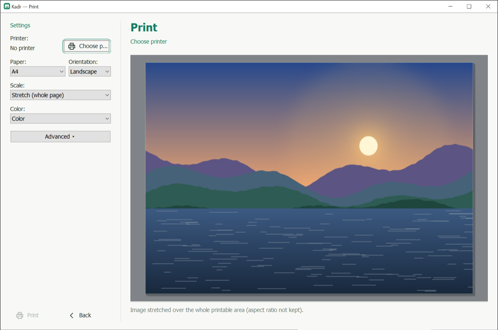

[English](README.md) | [Polski](README.pl.md) | [Español](README.es.md) | [Français](README.fr.md) | [Deutsch](README.de.md) | [Português](README.pt.md) | [Русский](README.ru.md) | [Українська](README.uk.md) | [Italiano](README.it.md) | [Nederlands](README.nl.md) | [Čeština](README.cs.md) | [Magyar](README.hu.md) | [Română](README.ro.md) | [Türkçe](README.tr.md) | [Ελληνικά](README.el.md) | [العربية](README.ar.md) | [עברית](README.he.md) | [हिन्दी](README.hi.md) | [বাংলা](README.bn.md) | [اردو](README.ur.md) | [中文](README.zh.md) | [日本語](README.ja.md) | [한국어](README.ko.md) | **Bahasa Indonesia** | [Tiếng Việt](README.vi.md) | [ไทย](README.th.md) | [فارسی](README.fa.md) | [தமிழ்](README.ta.md) | [తెలుగు](README.te.md) | [मराठी](README.mr.md)

# Kadr

**Penampil dan editor foto untuk Windows yang cepat, mungil, dan portabel — dari Windows XP hingga Windows 11, dalam satu berkas `Kadr.exe` berukuran di bawah 1 MB.**

Kadr adalah aplikasi Win32/GDI+ native yang ditulis dalam [Zig](https://ziglang.org/). Tanpa installer, tanpa .NET, tanpa Electron, tanpa Node.js: salin `Kadr.exe` ke mana saja lalu jalankan. Pengaturan disimpan di `Kadr.ini` di samping program (portabel — tidak ada yang ditulis ke registry atau AppData).


## Daftar isi

- [Fitur](#fitur)
- [Tangkapan layar](#tangkapan-layar)
- [Unduh / Instalasi](#unduh--instalasi)
- [Penggunaan](#penggunaan)
- [Pintasan keyboard](#pintasan-keyboard)
- [Editor](#editor-1)
- [Pencetakan](#pencetakan)
- [Tema](#tema)
- [Pengaturan (Kadr.ini)](#pengaturan-kadrini)
- [Membangun dari kode sumber](#membangun-dari-kode-sumber)
- [Menjalankan pengujian](#menjalankan-pengujian)
- [Lisensi](#lisensi)
- [Kredit](#kredit)

## Fitur

- **Penampil** — membuka foto, menelusuri folder (tombol panah, sebelumnya/berikutnya), tayangan slide, layar penuh, zoom halus (sesuaikan, 1:1, roda mouse di posisi kursor, nilai yang diketik seperti `125%`, `37,5%` atau `200×`), menggeser gambar, memutar GIF animasi, TIFF dan DjVu multihalaman, orientasi EXIF otomatis.
- **Editor** — pangkas dengan bingkai langsung dan rasio siap pakai (bebas, 1:1, 4:3, 3:4, 3:2, 2:3, 16:9, A4 potret/lanskap); pena, stabilo, penghapus, garis, panah, persegi panjang, dan teks; urungkan/ulangi; putar dan balik; kecerahan, kontras, saturasi, serta hitam putih. Perubahan tetap di memori sampai Anda menyimpannya.
- **Pencetakan** — pratinjau cetak langsung dengan ukuran kertas, orientasi, skala (sesuaikan / isi (potong) / Stretch (seluruh halaman) / 100% / % khusus / lebar atau tinggi dalam mm), margin, posisi, warna atau skala abu-abu.
- **Alat berkas** — simpan (rotasi), simpan sebagai, ekspor / kompres (PNG, JPEG, BMP, TIFF, GIF) dengan pengubahan ukuran dan perkiraan ukuran berkas, salin gambar atau jalur ke papan klip, ganti nama, pindahkan ke Keranjang Sampah atau hapus permanen, tampilkan di folder, jadikan wallpaper desktop.
- **Format** — PNG, JPEG/JFIF, BMP/DIB, GIF, TIFF, DjVu, ICO, WMF/EMF, TGA, PCX, PSD (gambar gabungan), PBM/PGM/PPM/PNM, QOI.
- **30 bahasa antarmuka** — bahasa Windows terdeteksi otomatis (jika tidak tersedia, kembali ke bahasa Inggris) dan dapat diganti dari menu; tata letak kanan-ke-kiri untuk bahasa Arab, Ibrani, Urdu, dan Persia.
- **Tema** — terang, gelap, atau otomatis (mengikuti mode aplikasi Windows dan langsung berganti).
- **Kecil** — satu `Kadr.exe` berukuran kurang dari 1 MB.
- **Windows XP dan yang lebih baru** — berjalan di Windows XP SP3 (x86) hingga Windows 10/11.

## Tangkapan layar

| Tema terang | Tema gelap |
|---|---|
|  |  |

**Editor** — bingkai pangkas dengan rasio 3:2, pena, stabilo, panah, persegi panjang, dan teks:


**Pratinjau cetak** dalam mode *Stretch (whole page)* (rentangkan: seluruh halaman):



**Menu "Lainnya" (…)** dengan submenu *Tema*:


## Unduh / Instalasi

1. Unduh `Kadr.exe` dari [halaman Releases](https://github.com/snakex21/kadr/releases) (`Kadr.exe` siap pakai juga tersedia di folder akar repositori).
2. Letakkan di folder mana pun yang dapat Anda tulisi (misalnya flashdisk USB) lalu jalankan. Tidak ada installer.
3. Untuk berkas DjVu, simpan folder `deps\djvu\` dari repositori di samping `Kadr.exe`.

Agar gambar terbuka dengan klik ganda, gunakan *Buka dengan → Pilih aplikasi lain* di Windows pada sebuah gambar dan pilih `Kadr.exe`.

**Persyaratan:** Windows XP SP3 x86 atau yang lebih baru (Windows 10/11 juga bisa). Tidak perlu apa-apa lagi.

> Dekoder DjVu adalah DjVuLibre 3.5.27 versi lama — buka hanya berkas DjVu yang Anda percayai (detail di `THIRD-PARTY.txt`).

## Penggunaan

- **Buka** gambar dengan **Buka** (Ctrl+O), dengan menyeret berkas ke jendela, atau dengan memberikannya di baris perintah: `Kadr.exe photo.jpg`.
- **Telusuri** folder dengan ← / → atau tombol panah; penghitung menunjukkan posisi (mis. `1 / 3`). Tahan tombol panah untuk menelusuri dengan cepat.
- **Zoom** dengan roda mouse (zoom ke arah kursor), `+` / `−`, **Sesuaikan** (Home), **1:1** (`1`), atau ketik nilai di kolom zoom lalu tekan Enter. Seret gambar untuk menggesernya.
- **Putar** dengan R / L. Yang diputar adalah tampilannya; **Simpan** (Ctrl+S) menulis rotasi ke dalam berkas.
- **Lainnya (…)** membuka menu berisi semua operasi berkas, editor, cetak, tayangan slide, layar penuh, bantuan, *Periksa pembaruan…*, *Tema*, dan *Bahasa*.
- **Periksa pembaruan…** hanya membuka halaman rilis GitHub proyek ini di peramban web Anda — Kadr sendiri tidak pernah terhubung ke internet.

## Pintasan keyboard

### Penampil

| Pintasan | Tindakan |
|---|---|
| Ctrl+O | Buka |
| Ctrl+S | Simpan (menulis rotasi ke berkas saat ini) |
| Ctrl+Shift+S | Simpan sebagai |
| Ctrl+E | Edit gambar |
| Ctrl+P | Cetak |
| Ctrl+C | Salin gambar |
| Ctrl+Shift+C | Salin jalur |
| F2 | Ganti nama |
| Delete | Pindahkan ke Keranjang Sampah |
| Shift+Delete | Hapus permanen |
| ← / → | Gambar sebelumnya / berikutnya di folder (tahan untuk menelusuri dengan cepat) |
| Home | Sesuaikan dengan jendela |
| 1 | Ukuran asli (1:1) |
| + / − (juga keypad numerik) | Perbesar / perkecil |
| Roda mouse | Zoom di posisi kursor |
| Seret dengan tombol kiri | Geser gambar |
| Klik ganda | Layar penuh aktif / nonaktif |
| R / L | Putar ke kanan / ke kiri |
| Spasi | Jeda / lanjutkan animasi |
| Page Up / Page Down | Halaman sebelumnya / berikutnya (TIFF, DjVu) |
| F5 | Tayangan slide (setiap 4 detik) |
| F11 | Layar penuh |
| Esc | Keluar dari layar penuh, hentikan tayangan slide |
| F1 | Bantuan dan pintasan |
| Shift+F10 atau tombol Menu | Menu "Lainnya" (juga lewat klik kanan pada gambar) |
| Tab / Shift+Tab, Enter atau Spasi | Berpindah antar tombol bilah alat dan menekannya |

### Kolom zoom

| Pintasan | Tindakan |
|---|---|
| Enter | Terapkan zoom yang diketik (`125%`, `37,5%`, `200×` …) |
| Esc | Kembalikan nilai saat ini |
| Ctrl+A | Pilih semua |

### Editor

| Pintasan | Tindakan |
|---|---|
| C | Pangkas |
| P | Pen (pena) |
| H | Highlighter (stabilo) |
| E | Eraser (penghapus) |
| L | Line (garis) |
| A | Arrow (panah) |
| B | Rectangle (persegi panjang) |
| T | Text (teks) |
| Ctrl+Z | Undo (urungkan) |
| Ctrl+Y atau Ctrl+Shift+Z | Redo (ulangi) |
| Enter (alat Pangkas) atau klik ganda | Potong bagian yang digelapkan |
| Enter / Esc (saat mengetik teks) | Selesaikan / batalkan teks |
| Esc | Tutup editor tanpa perubahan |

### Pratinjau cetak

| Pintasan | Tindakan |
|---|---|
| Seret gambar di atas lembar | Mengubah posisinya |
| Esc | Tutup pratinjau (membatalkan pekerjaan cetak yang sedang berjalan) |

## Editor

Buka editor dengan **Edit** (Ctrl+E). Semua perubahan disimpan di memori; berkas asli tidak diubah sampai Anda menyimpannya.

- **Pangkas** — bingkai langsung dengan delapan pegangan; seret bingkai atau pegangannya, ketik X / Y / lebar / tinggi yang tepat dalam piksel, atau pilih rasio siap pakai (bebas, persegi 1:1, 4:3, 3:4, 3:2 (4×6 lanskap), 2:3, 16:9, A4 potret, A4 lanskap). Area di luar bingkai digelapkan; **Pangkas** (Enter) memotongnya dan **Whole photo** (seluruh foto) mengatur ulang bingkai.
- **Menggambar** — pena, stabilo tembus pandang, penghapus (hanya menghapus coretan dan teks, tidak pernah fotonya), garis lurus, panah, persegi panjang, dan teks, dengan sepuluh warna dan ketebalan yang dapat diatur.
- **Gambar** — urungkan / ulangi, putar 90° ke kiri atau ke kanan, cerminkan secara horizontal atau vertikal, atur ulang semua.
- **Warna dan cahaya** — kecerahan, kontras, saturasi, serta hitam putih.
- **Selesai** — *Terapkan* mengembalikan gambar yang sudah diedit ke penampil, *Save as…* (simpan sebagai) menyimpan salinan dengan nama baru, *Print…* (cetak) langsung membuka pratinjau cetak, *Batal* (Esc) membuang perubahan.

## Pencetakan

**Cetak** (Ctrl+P) membuka pratinjau lembar secara langsung. Pilih printer, kertas (A3–A6, B4/B5, Letter, Legal, Executive, Tabloid, ukuran foto 10×15, 13×18, 15×20, 20×25 cm, 4×6, 5×7, 8×10 in, ukuran khusus atau milik printer), orientasi, serta warna atau skala abu-abu. Orientasi mengikuti gambar secara otomatis sampai Anda mengubahnya.

Mode skala:

| Mode | Fungsinya |
|---|---|
| **Sesuaikan** | Seluruh gambar muat di dalam margin; proporsi dipertahankan, ruang putih mungkin tersisa di dua sisi. |
| **Isi / potong** | Gambar menutupi seluruh area cetak; proporsi dipertahankan dan tepi yang berlebih dipotong. |
| **Stretch (whole page)** | Gambar direntangkan tepat ke area cetak — tanpa bilah putih, tetapi proporsi **tidak** dipertahankan. |
| **100% · Ukuran asli (96 DPI)** | Satu piksel = 1/96 inci. |
| **Persentase khusus** | 0,1–1000% relatif terhadap 96 DPI (100% = ukuran di atas). |
| **Lebar (mm) / Tinggi (mm)** | Lebar atau tinggi fisik yang tepat; sisi lainnya mengikuti proporsi. |

**Lanjutan ▸** menambahkan ukuran kertas khusus, margin, dan posisi yang tepat di lembar (atau seret gambar di pratinjau; *Tengahkan* mengembalikannya ke tengah). Garis abu-abu menunjukkan batas perangkat keras printer. Mode skala yang terakhir dipilih diingat di `Kadr.ini`.

## Tema

**Lainnya (…) → Tema** menyediakan **Terang**, **Gelap**, dan **Otomatis** (bawaan).

- **Otomatis** mengikuti *mode aplikasi* Windows (Pengaturan → Personalisasi → Warna, nilai `AppsUseLightTheme`) dan langsung berganti saat Anda mengubahnya di Windows. Pada sistem tanpa pengaturan tersebut (Windows XP, Vista, 7, 8), Otomatis berarti Terang.
- Tema berlaku untuk jendela utama, bilah alat, tombol dan ikon, editor, pratinjau cetak, dan dialog milik Kadr sendiri. Dalam mode gelap, latar belakang gambar berwarna abu-abu gelap, dan di Windows 10/11 bilah judul serta menu pop-up juga gelap.
- Beberapa bagian bawaan Windows tetap memakai tampilan sistem: kotak pesan (bantuan, konfirmasi), dialog sistem Buka / Simpan / Cetak, dan kenop penggeser.

## Pengaturan (Kadr.ini)

Semua pengaturan disimpan di `Kadr.ini` di samping `Kadr.exe`. Jika folder bersifat hanya-baca, Kadr akan memberi tahu bahwa pengaturan tidak dapat disimpan.

```ini
[General]
Language=en      ; pl, en, es, fr, de, pt, ru, uk, it, nl, cs, hu, ro, tr, el, ar, he, hi, bn, ur, zh, ja, ko, id, vi, th, fa, ta, te, mr
Theme=auto       ; auto, light or dark
[Print]
Scale=fit        ; fit, fill, stretch, actual, percent, width or height
```

Bahasa juga dapat dipilih melalui **Lainnya (…) → Bahasa**; perubahan berlaku setelah Kadr dimulai ulang. Tema langsung diterapkan.

Bahasa antarmuka: Polski, English, Español, Français, Deutsch, Português, Русский, Українська, Italiano, Nederlands, Čeština, Magyar, Română, Türkçe, Ελληνικά, العربية, עברית, हिन्दी, বাংলা, اردو, 中文, 日本語, 한국어, Bahasa Indonesia, Tiếng Việt, ไทย, فارسی, தமிழ், తెలుగు, मराठी.

## Membangun dari kode sumber

Persyaratan: [Zig 0.11.0](https://ziglang.org/download/0.11.0/zig-windows-x86_64-0.11.0.zip) yang diekstrak ke `tools\zig-windows-x86_64-0.11.0\` (arsipnya tidak termasuk dalam repositori; SHA-256-nya tercantum di `THIRD-PARTY.txt`).

```bat
build.cmd
```

Hasilnya adalah `Kadr.exe` (target `x86-windows.xp`, Pentium III, `ReleaseSmall`) dengan header PE yang kompatibel dengan XP. Membuat ulang ikon: `tools\build_icon.cmd` (Pillow + windres/objcopy).

Kadr hanya ditautkan ke pustaka yang tersedia di Windows XP. Fitur yang lebih baru (bilah judul gelap, menu dan kontrol gelap) dimuat saat runtime dengan `LoadLibrary` / `GetProcAddress` dan dilewati pada sistem lama.

## Menjalankan pengujian

- Rangkaian pengujian berada di subfolder `tests\` (`editor-check`, `print-options`, `loader-check`, `image-check`, `codec-check`, `render-check`, `export-check`); masing-masing dijalankan dengan `check.cmd` miliknya, yang membangun dan menjalankan harness Zig. `tests\editor-check\check.cmd` menjalankan pengujian jendela utama (termasuk pengujian pengaturan tema dan resolusi tema), pengujian editor, pemeriksaan cakupan bahasa, dan build kandidat x86/XP; `tests\print-options\check.cmd` menjalankan pengujian pencetakan dan tata letak.
- Pengujian unit dalam modul tunggal dapat dijalankan dengan `zig test`, mis. `zig test src\toolbar.zig`, `src\navigation.zig`, `src\image.zig`, `src\zoom.zig`, `src\theme.zig` (dengan target dan flag include yang sama seperti di `check.cmd`).
- Skrip bantu Python 3: `python tests\i18n-check\run.py` (pemilihan bahasa), `python tests\locale_coverage.py` (semua teks UI ada di katalog untuk 30 bahasa), `python tests\audit_xp.py` (audit impor/header XP pada `Kadr.exe`), `tests\measure_print.py`, `tests\tooltip_probe.py`, `tests\shot.py`.
- `tests\generate_fixtures.py` membuat gambar uji (memerlukan Pillow); skrip ini hanya digunakan untuk pengembangan, tidak pernah oleh `Kadr.exe`.

## Lisensi

**GPL-3.0-or-later** — teks lengkap di [`LICENSE`](LICENSE).

Komponen pihak ketiga dan lisensinya (DjVuLibre, VC100/GDI+, Zig): [`THIRD-PARTY.txt`](THIRD-PARTY.txt). Teks GNU GPL v2 untuk DjVuLibre: [`COPYING.txt`](COPYING.txt).

Ini adalah terjemahan; versi bahasa Inggris ([README.md](README.md)) yang berlaku.

## Kredit

- Dibangun dengan [Zig](https://ziglang.org/) di atas Win32 dan GDI+.
- Dekode DjVu: [DjVuLibre](https://djvu.sourceforge.net/) 3.5.27 (GPL-2.0-or-later).
- Ikon antarmuka dan logo Kadr adalah karya asli proyek ini (`src/ui.zig`, `tools/make_icon.py`).
- Gambar dalam tangkapan layar adalah gambar sintetis yang dibuat untuk README ini.
