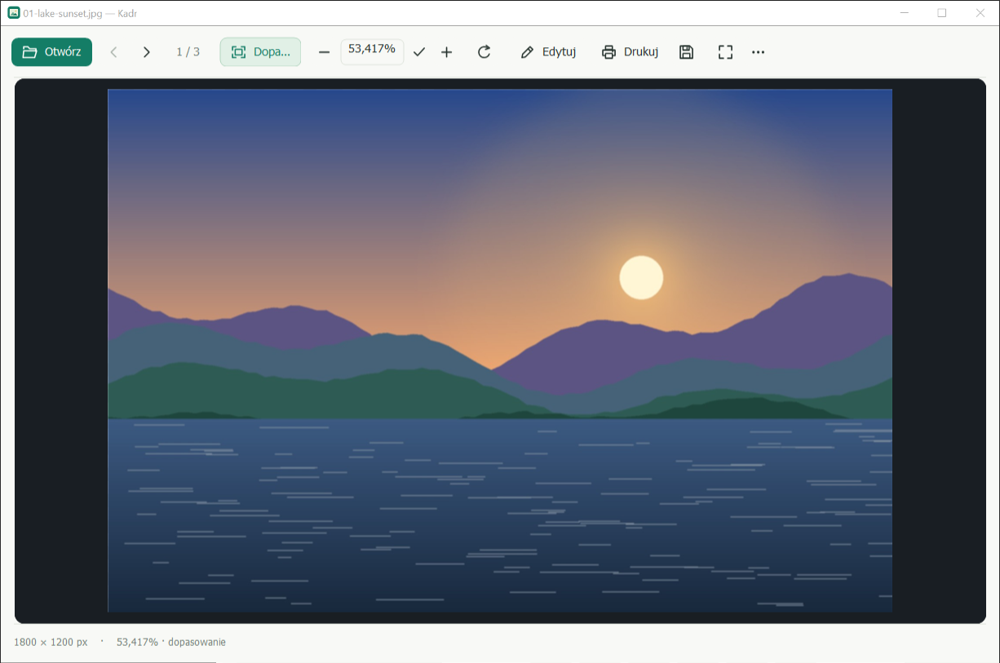
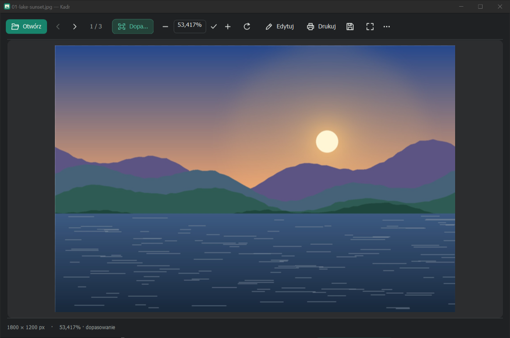
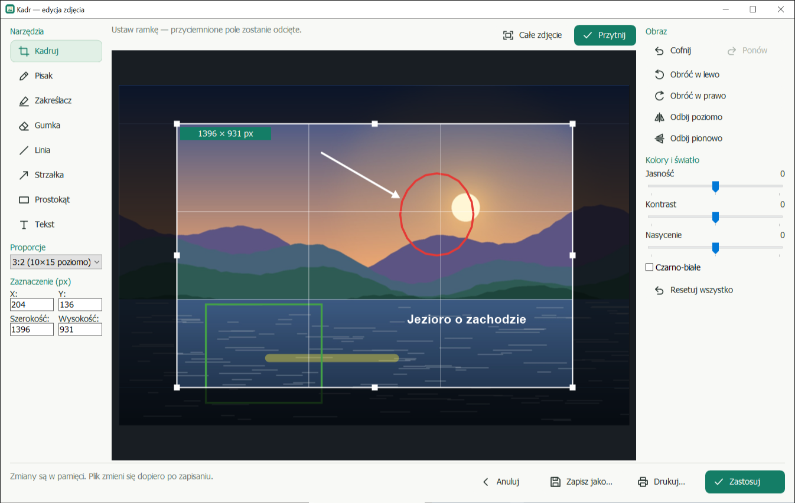
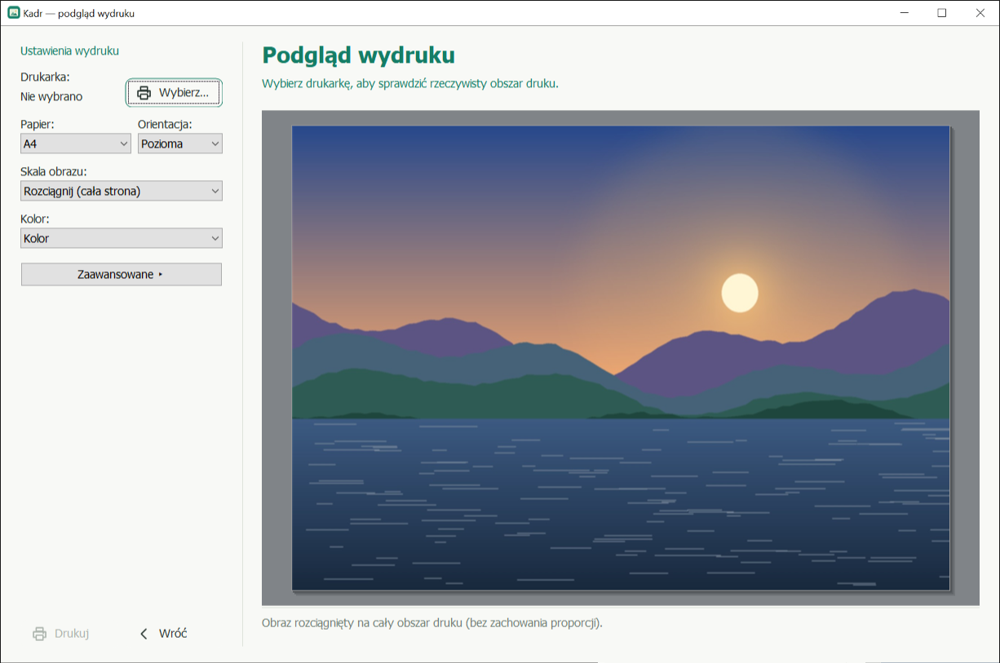
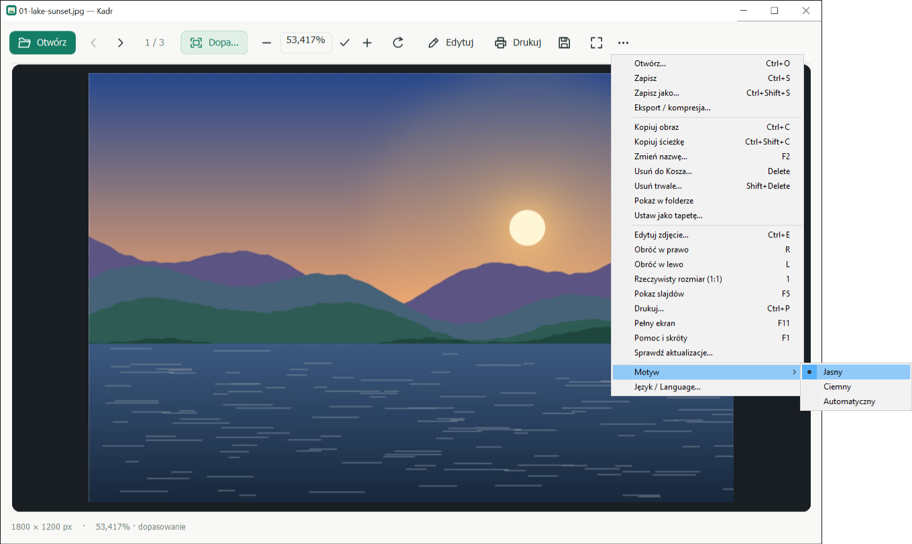

[English](README.md) | **Polski** | [Español](README.es.md) | [Français](README.fr.md) | [Deutsch](README.de.md) | [Português](README.pt.md) | [Русский](README.ru.md) | [Українська](README.uk.md) | [Italiano](README.it.md) | [Nederlands](README.nl.md) | [Čeština](README.cs.md) | [Magyar](README.hu.md) | [Română](README.ro.md) | [Türkçe](README.tr.md) | [Ελληνικά](README.el.md) | [العربية](README.ar.md) | [עברית](README.he.md) | [हिन्दी](README.hi.md) | [বাংলা](README.bn.md) | [اردو](README.ur.md) | [中文](README.zh.md) | [日本語](README.ja.md) | [한국어](README.ko.md) | [Bahasa Indonesia](README.id.md) | [Tiếng Việt](README.vi.md) | [ไทย](README.th.md) | [فارسی](README.fa.md) | [தமிழ்](README.ta.md) | [తెలుగు](README.te.md) | [मराठी](README.mr.md)

# Kadr

**Szybka, maleńka, przenośna przeglądarka i edytor zdjęć dla Windows — od Windows XP do Windows 11, w jednym pliku `Kadr.exe` mniejszym niż 1 MB.**

Kadr to natywna aplikacja Win32/GDI+ napisana w [Zigu](https://ziglang.org/). Bez instalatora, bez .NET, Electrona i Node.js: skopiuj `Kadr.exe` gdziekolwiek i uruchom. Ustawienia trafiają do `Kadr.ini` obok programu (wersja przenośna — nic nie jest zapisywane w rejestrze ani w AppData).



## Spis treści

- [Możliwości](#możliwości)
- [Zrzuty ekranu](#zrzuty-ekranu)
- [Pobieranie / instalacja](#pobieranie--instalacja)
- [Użytkowanie](#użytkowanie)
- [Skróty klawiszowe](#skróty-klawiszowe)
- [Edytor](#edytor-1)
- [Drukowanie](#drukowanie)
- [Motywy](#motywy)
- [Ustawienia (Kadr.ini)](#ustawienia-kadrini)
- [Kompilacja ze źródeł](#kompilacja-ze-źródeł)
- [Uruchamianie testów](#uruchamianie-testów)
- [Licencja](#licencja)
- [Podziękowania](#podziękowania)

## Możliwości

- **Przeglądarka** — otwieranie zdjęć, nawigacja po folderze (strzałki, poprzednie/następne), pokaz slajdów, pełny ekran, płynny zoom (dopasowanie, 1:1, kółko myszy w miejscu kursora, wpisywane wartości, np. `125%`, `37,5%` lub `200×`), przesuwanie, odtwarzanie animowanych GIF-ów, wielostronicowe TIFF i DjVu, automatyczna orientacja EXIF.
- **Edytor** — kadrowanie z ramką na żywo i gotowymi proporcjami (dowolne, 1:1, 4:3, 3:4, 3:2, 2:3, 16:9, A4 pionowo/poziomo); pisak, zakreślacz, gumka, linia, strzałka, prostokąt i tekst; cofnij/ponów; obrót i odbicia; jasność, kontrast, nasycenie i czerń-biel. Zmiany zostają w pamięci, dopóki ich nie zapiszesz.
- **Drukowanie** — podgląd wydruku na żywo z wyborem papieru, orientacji, skali (Dopasuj / Wypełnij (przytnij) / Rozciągnij (cała strona) / 100% / własny procent / szerokość lub wysokość w mm), marginesów, położenia, koloru lub skali szarości.
- **Operacje na plikach** — zapis (obrotu), zapis jako, eksport / kompresja (PNG, JPEG, BMP, TIFF, GIF) ze zmianą rozmiaru i szacowaniem wielkości pliku, kopiowanie obrazu lub ścieżki do schowka, zmiana nazwy, usuwanie do Kosza lub trwale, pokazanie w folderze, ustawienie jako tapety pulpitu.
- **Formaty** — PNG, JPEG/JFIF, BMP/DIB, GIF, TIFF, DjVu, ICO, WMF/EMF, TGA, PCX, PSD (scalony obraz), PBM/PGM/PPM/PNM, QOI.
- **30 języków interfejsu** — język Windows jest wykrywany automatycznie (z odesłaniem na angielski) i można go zmienić z menu; układ od prawej do lewej dla arabskiego, hebrajskiego, urdu i perskiego.
- **Motywy** — jasny, ciemny lub automatyczny (podąża za trybem aplikacji Windows i przełącza się na żywo).
- **Mały rozmiar** — jeden `Kadr.exe` mniejszy niż 1 MB.
- **Windows XP i nowsze** — działa od Windows XP SP3 (x86) do Windows 10/11.

## Zrzuty ekranu

| Motyw jasny | Motyw ciemny |
|---|---|
|  |  |

**Edytor** — ramka kadrowania z proporcjami 3:2, pisak, zakreślacz, strzałka, prostokąt i tekst:



**Podgląd wydruku** w trybie *Rozciągnij (cała strona)*:



**Menu „Więcej” (…)** z podmenu *Motyw*:



## Pobieranie / instalacja

1. Pobierz `Kadr.exe` ze [strony wydań (Releases)](https://github.com/snakex21/kadr/releases) (gotowy `Kadr.exe` leży też w katalogu głównym repozytorium).
2. Umieść go w dowolnym folderze z prawem zapisu (np. na pendrivie) i uruchom. Nie ma instalatora.
3. Do plików DjVu zachowaj obok `Kadr.exe` folder `deps\djvu\` z repozytorium.

Aby otwierać zdjęcia dwuklikiem, użyj w Windows *Otwórz za pomocą → Wybierz inną aplikację* na pliku obrazu i wskaż `Kadr.exe`.

**Wymagania:** Windows XP SP3 x86 lub nowszy (działa też na Windows 10/11). Nic więcej.

> Dekoder DjVu to starszy DjVuLibre 3.5.27 — otwieraj tylko zaufane pliki DjVu (szczegóły w `THIRD-PARTY.txt`).

## Użytkowanie

- **Otwórz** zdjęcie przyciskiem **Otwórz** (Ctrl+O), przeciągając plik na okno albo podając go w wierszu poleceń: `Kadr.exe zdjecie.jpg`.
- **Przeglądaj** folder strzałkami ← / → lub przyciskami ze strzałkami; licznik pokazuje pozycję (np. `1 / 3`). Przytrzymaj strzałkę, aby szybko przewijać.
- **Powiększaj** kółkiem myszy (zoom w miejscu kursora), klawiszami `+` / `−`, przyciskiem **Dopasuj** (Home), **1:1** (`1`) lub wpisz wartość w pole zoomu i naciśnij Enter. Przeciągnij obraz, aby go przesunąć.
- **Obracaj** klawiszami R / L. Obracany jest widok; **Zapisz** (Ctrl+S) zapisuje obrót w pliku.
- **Więcej (…)** otwiera menu ze wszystkimi operacjami na plikach, edytorem, drukowaniem, pokazem slajdów, pełnym ekranem, pomocą, pozycją *Sprawdź aktualizacje…*, *Motyw* i *Język*.
- **Sprawdź aktualizacje…** tylko otwiera stronę wydań projektu na GitHubie w przeglądarce — sam Kadr nigdy nie łączy się z internetem.

## Skróty klawiszowe

### Przeglądarka

| Skrót | Działanie |
|---|---|
| Ctrl+O | Otwórz |
| Ctrl+S | Zapisz (zapisuje obrót w bieżącym pliku) |
| Ctrl+Shift+S | Zapisz jako |
| Ctrl+E | Edytuj zdjęcie |
| Ctrl+P | Drukuj |
| Ctrl+C | Kopiuj obraz |
| Ctrl+Shift+C | Kopiuj ścieżkę |
| F2 | Zmień nazwę |
| Delete | Usuń do Kosza |
| Shift+Delete | Usuń trwale |
| ← / → | Poprzednie / następne zdjęcie w folderze (przytrzymaj, aby szybko przewijać) |
| Home | Dopasuj do okna |
| 1 | Rzeczywisty rozmiar (1:1) |
| + / − (także na klawiaturze numerycznej) | Powiększ / pomniejsz |
| Kółko myszy | Zoom w miejscu kursora |
| Przeciąganie lewym przyciskiem | Przesuwanie obrazu |
| Dwuklik | Pełny ekran wł. / wył. |
| R / L | Obróć w prawo / w lewo |
| Spacja | Pauza / wznowienie animacji |
| Page Up / Page Down | Poprzednia / następna strona (TIFF, DjVu) |
| F5 | Pokaz slajdów (co 4 sekundy) |
| F11 | Pełny ekran |
| Esc | Wyjście z pełnego ekranu, zatrzymanie pokazu slajdów |
| F1 | Pomoc i skróty |
| Shift+F10 lub klawisz Menu | Menu „Więcej” (także prawy klik na obrazie) |
| Tab / Shift+Tab, Enter lub Spacja | Przechodzenie między przyciskami paska i ich naciskanie |

### Pole zoomu

| Skrót | Działanie |
|---|---|
| Enter | Zastosuj wpisany zoom (`125%`, `37,5%`, `200×` …) |
| Esc | Przywróć bieżącą wartość |
| Ctrl+A | Zaznacz wszystko |

### Edytor

| Skrót | Działanie |
|---|---|
| C | Kadruj |
| P | Pisak |
| H | Zakreślacz |
| E | Gumka |
| L | Linia |
| A | Strzałka |
| B | Prostokąt |
| T | Tekst |
| Ctrl+Z | Cofnij |
| Ctrl+Y lub Ctrl+Shift+Z | Ponów |
| Enter (narzędzie Kadruj) lub dwuklik | Odetnij przyciemnioną część |
| Enter / Esc (podczas pisania tekstu) | Zakończ / anuluj tekst |
| Esc | Zamknij edytor bez zmian |

### Podgląd wydruku

| Skrót | Działanie |
|---|---|
| Przeciąganie obrazu na arkuszu | Zmiana jego położenia |
| Esc | Zamknij podgląd (przerywa trwające drukowanie) |

## Edytor

Edytor otwiera przycisk **Edytuj** (Ctrl+E). Wszystkie zmiany są trzymane w pamięci; oryginalny plik pozostaje nietknięty, dopóki nie zapiszesz.

- **Kadrowanie** — ramka na żywo z ośmioma uchwytami; przeciągaj ramkę lub uchwyty, wpisz dokładne X / Y / szerokość / wysokość w pikselach albo wybierz proporcje (dowolne, kwadrat 1:1, 4:3 poziomo, 3:4 pionowo, 3:2 (10×15 poziomo), 2:3 (10×15 pionowo), 16:9, A4 pionowo, A4 poziomo). Obszar poza ramką jest przyciemniony; **Przytnij** (Enter) go odcina, a **Całe zdjęcie** przywraca ramkę.
- **Rysowanie** — pisak, półprzezroczysty zakreślacz, gumka (ściera tylko rysunki i napisy, nigdy zdjęcie), prosta linia, strzałka, prostokąt i tekst, z dziesięcioma kolorami i regulowaną grubością.
- **Obraz** — cofnij / ponów, obrót o 90° w lewo lub w prawo, odbicie lustrzane w poziomie lub w pionie, resetuj wszystko.
- **Kolory i światło** — jasność, kontrast, nasycenie i czerń-biel.
- **Zakończenie** — *Zastosuj* wraca z poprawionym obrazem do przeglądarki, *Zapisz jako…* zapisuje kopię pod nową nazwą, *Drukuj…* przechodzi od razu do podglądu wydruku, *Anuluj* (Esc) odrzuca zmiany.

## Drukowanie

**Drukuj** (Ctrl+P) otwiera podgląd arkusza na żywo. Wybierz drukarkę, papier (A3–A6, B4/B5, Letter, Legal, Executive, Tabloid, formaty odbitek 10×15, 13×18, 15×20, 20×25 cm, 4×6, 5×7, 8×10 cali, własny lub z drukarki), orientację oraz kolor lub skalę szarości. Orientacja dopasowuje się do zdjęcia automatycznie, dopóki jej nie zmienisz.

Tryby skali:

| Tryb | Działanie |
|---|---|
| **Dopasuj (cały obraz)** | Całe zdjęcie mieści się w marginesach; proporcje są zachowane, po dwóch stronach może zostać biały pas. |
| **Wypełnij (przytnij)** | Zdjęcie pokrywa cały obszar druku; proporcje są zachowane, a wystające brzegi zostają przycięte. |
| **Rozciągnij (cała strona)** | Zdjęcie jest rozciągnięte dokładnie na obszar druku — bez białych pasów, ale **bez** zachowania proporcji. |
| **100% (96 DPI)** | Jeden piksel = 1/96 cala. |
| **Własny procent** | 0,1–1000% względem 96 DPI (100% = rozmiar powyżej). |
| **Szerokość / wysokość (mm)** | Dokładna fizyczna szerokość lub wysokość; drugi wymiar wynika z proporcji. |

**Zaawansowane ▸** dodaje własny rozmiar papieru, marginesy i dokładne położenie na arkuszu (albo przeciągnij zdjęcie w podglądzie; *Wyśrodkuj / reset pozycji* ustawia je z powrotem na środku). Szara linia pokazuje sprzętową granicę drukarki. Ostatnio wybrany tryb skali jest zapamiętywany w `Kadr.ini`.

## Motywy

**Więcej (…) → Motyw** oferuje **Jasny**, **Ciemny** i **Automatyczny** (domyślny).

- **Automatyczny** podąża za *trybem aplikacji* Windows (Ustawienia → Personalizacja → Kolory, wartość `AppsUseLightTheme`) i przełącza się na żywo, gdy zmienisz go w Windows. W systemach bez tego ustawienia (Windows XP, Vista, 7, 8) Automatyczny oznacza Jasny.
- Motyw obejmuje główne okno, pasek narzędzi, przyciski i ikony, edytor, podgląd wydruku oraz własne okna dialogowe Kadra. W trybie ciemnym tło zdjęcia jest ciemnoszare, a w Windows 10/11 ciemne są też paski tytułu i menu.
- Kilka natywnych elementów Windows zachowuje wygląd systemowy: okna komunikatów (pomoc, potwierdzenia), systemowe okna Otwórz / Zapisz / Drukuj oraz suwaki.

## Ustawienia (Kadr.ini)

Wszystkie ustawienia są zapisywane w `Kadr.ini` obok `Kadr.exe`. Jeśli folder jest tylko do odczytu, Kadr informuje, że nie może zapisać ustawień.

```ini
[General]
Language=pl      ; pl, en, es, fr, de, pt, ru, uk, it, nl, cs, hu, ro, tr, el, ar, he, hi, bn, ur, zh, ja, ko, id, vi, th, fa, ta, te, mr
Theme=auto       ; auto, light lub dark
[Print]
Scale=fit        ; fit, fill, stretch, actual, percent, width lub height
```

Język można też wybrać w **Więcej (…) → Język / Language…**; zmiana działa po ponownym uruchomieniu Kadra. Motyw działa natychmiast.

Języki interfejsu: Polski, English, Español, Français, Deutsch, Português, Русский, Українська, Italiano, Nederlands, Čeština, Magyar, Română, Türkçe, Ελληνικά, العربية, עברית, हिन्दी, বাংলা, اردو, 中文, 日本語, 한국어, Bahasa Indonesia, Tiếng Việt, ไทย, فارسی, தமிழ், తెలుగు, मराठी.

## Kompilacja ze źródeł

Wymagania: [Zig 0.11.0](https://ziglang.org/download/0.11.0/zig-windows-x86_64-0.11.0.zip) rozpakowany do `tools\zig-windows-x86_64-0.11.0\` (archiwum nie jest częścią repozytorium; jego suma SHA-256 jest w `THIRD-PARTY.txt`).

```bat
build.cmd
```

Wynik to `Kadr.exe` (cel `x86-windows.xp`, Pentium III, `ReleaseSmall`) z nagłówkiem PE zgodnym z XP. Regeneracja ikony: `tools\build_icon.cmd` (Pillow + windres/objcopy).

Kadr linkuje tylko biblioteki dostępne w Windows XP. Nowsze funkcje (ciemne paski tytułu, ciemne menu i kontrolki) są ładowane w czasie działania przez `LoadLibrary` / `GetProcAddress` i pomijane w starszych systemach.

## Uruchamianie testów

- Zestawy testów leżą w podkatalogach `tests\` (`editor-check`, `print-options`, `loader-check`, `image-check`, `codec-check`, `render-check`, `export-check`); każdy uruchamia się skryptem `check.cmd`, który buduje i odpala harnessy w Zigu. `tests\editor-check\check.cmd` uruchamia testy głównego okna (w tym testy ustawienia motywu i rozstrzygania motywu), testy edytora, kontrolę pokrycia tłumaczeń i próbną kompilację x86/XP; `tests\print-options\check.cmd` uruchamia testy drukowania i układu strony.
- Testy jednostkowe pojedynczych modułów uruchamia `zig test`, np. `zig test src\toolbar.zig`, `src\navigation.zig`, `src\image.zig`, `src\zoom.zig`, `src\theme.zig` (z tymi samymi flagami celu i nagłówków co w `check.cmd`).
- Skrypty pomocnicze (Python 3): `python tests\i18n-check\run.py` (wybór języka), `python tests\locale_coverage.py` (wszystkie teksty interfejsu są w katalogu dla 30 języków), `python tests\audit_xp.py` (audyt importów i nagłówka `Kadr.exe` pod kątem XP), `tests\measure_print.py`, `tests\tooltip_probe.py`, `tests\shot.py`.
- `tests\generate_fixtures.py` tworzy obrazy testowe (wymaga Pillow); służy tylko do prac rozwojowych, nigdy nie używa go `Kadr.exe`.

## Licencja

**GPL-3.0-or-later** — pełny tekst w pliku [`LICENSE`](LICENSE).

Komponenty zewnętrzne i ich licencje (DjVuLibre, VC100/GDI+, Zig): [`THIRD-PARTY.txt`](THIRD-PARTY.txt). Tekst GNU GPL v2 dla DjVuLibre: [`COPYING.txt`](COPYING.txt).

## Podziękowania

- Zbudowane w [Zigu](https://ziglang.org/) na Win32 i GDI+.
- Dekodowanie DjVu: [DjVuLibre](https://djvu.sourceforge.net/) 3.5.27 (GPL-2.0-or-later).
- Ikony interfejsu i logo Kadra to oryginalna grafika projektu (`src/ui.zig`, `tools/make_icon.py`).
- Zdjęcia na zrzutach ekranu to syntetyczne obrazy wygenerowane na potrzeby tego README.
