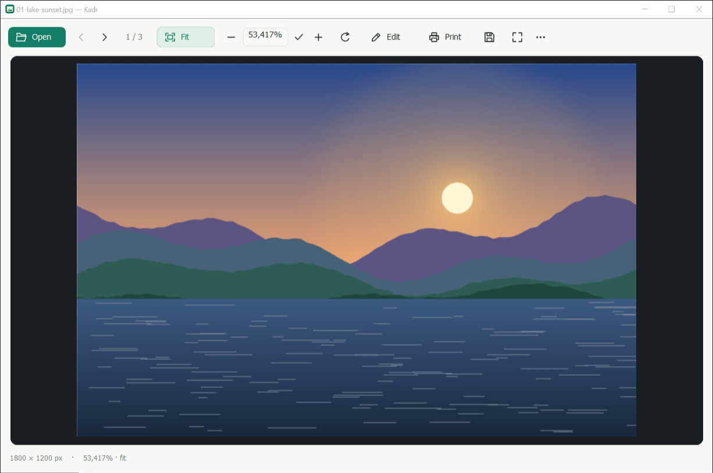

[English](../README.md) | [Polski](README.pl.md) | [Español](README.es.md) | [Français](README.fr.md) | [Deutsch](README.de.md) | [Português](README.pt.md) | [Русский](README.ru.md) | [Українська](README.uk.md) | [Italiano](README.it.md) | [Nederlands](README.nl.md) | [Čeština](README.cs.md) | [Magyar](README.hu.md) | [Română](README.ro.md) | [Türkçe](README.tr.md) | [Ελληνικά](README.el.md) | [العربية](README.ar.md) | [עברית](README.he.md) | [हिन्दी](README.hi.md) | **বাংলা** | [اردو](README.ur.md) | [中文](README.zh.md) | [日本語](README.ja.md) | [한국어](README.ko.md) | [Bahasa Indonesia](README.id.md) | [Tiếng Việt](README.vi.md) | [ไทย](README.th.md) | [فارسی](README.fa.md) | [தமிழ்](README.ta.md) | [తెలుగు](README.te.md) | [मराठी](README.mr.md)

# Kadr

**Windows-এর জন্য দ্রুত, ছোট্ট, পোর্টেবল ছবি দর্শক ও সম্পাদক — Windows XP থেকে Windows 11 পর্যন্ত, 1 MB-এর কম একটিমাত্র `Kadr.exe` ফাইলে।**

Kadr হলো [Zig](https://ziglang.org/)-এ লেখা একটি নেটিভ Win32/GDI+ অ্যাপ্লিকেশন। কোনো ইনস্টলার নেই, .NET নেই, Electron নেই, Node.js নেই: `Kadr.exe` যেকোনো জায়গায় কপি করে চালান। সেটিংস প্রোগ্রামের পাশে `Kadr.ini` ফাইলে রাখা হয় (পোর্টেবল — রেজিস্ট্রি বা AppData-তে কিছুই লেখা হয় না)।



## সূচিপত্র

- [বৈশিষ্ট্য](#বৈশিষ্ট্য)
- [স্ক্রিনশট](#স্ক্রিনশট)
- [ডাউনলোড / ইনস্টলেশন](#ডাউনলোড--ইনস্টলেশন)
- [ব্যবহার](#ব্যবহার)
- [কিবোর্ড শর্টকাট](#কিবোর্ড-শর্টকাট)
- [সম্পাদক](#সম্পাদক-1)
- [প্রিন্ট](#প্রিন্ট)
- [থিম](#থিম)
- [সেটিংস (Kadr.ini)](#সেটিংস-kadrini)
- [সোর্স থেকে বিল্ড](#সোর্স-থেকে-বিল্ড)
- [টেস্ট চালানো](#টেস্ট-চালানো)
- [লাইসেন্স](#লাইসেন্স)
- [কৃতজ্ঞতা](#কৃতজ্ঞতা)

## বৈশিষ্ট্য

- **দর্শক** — ছবি খোলা, ফোল্ডার ব্রাউজ করা (তীর কী, আগের/পরের), স্লাইড শো, পূর্ণ পর্দা, মসৃণ জুম (মানানসই, 1:1, কার্সরের জায়গায় মাউস হুইল, `125%`, `37,5%` বা `200×`-এর মতো টাইপ করা মান), ছবি সরানো, অ্যানিমেটেড GIF চালানো, বহু-পৃষ্ঠার TIFF ও DjVu, স্বয়ংক্রিয় EXIF অভিমুখ।
- **সম্পাদক** — লাইভ ফ্রেম ও তৈরি অনুপাত (মুক্ত, 1:1, 4:3, 3:4, 3:2, 2:3, 16:9, A4 খাড়া/আড়াআড়ি) দিয়ে ক্রপ; কলম, হাইলাইটার, ইরেজার, রেখা, তীর, আয়তক্ষেত্র ও লেখা; পূর্বাবস্থা/পুনরায়; ঘোরানো ও উল্টানো; উজ্জ্বলতা, কনট্রাস্ট, স্যাচুরেশন ও সাদা-কালো। সংরক্ষণ না করা পর্যন্ত পরিবর্তনগুলো মেমরিতেই থাকে।
- **প্রিন্ট** — লাইভ প্রিন্ট প্রিভিউ, সঙ্গে কাগজের আকার, অভিমুখ, স্কেল (মানানসই / ভরাট (ছাঁটাই) / প্রসারিত (পুরো পৃষ্ঠা) / 100% / নিজস্ব % / mm-এ প্রস্থ বা উচ্চতা), মার্জিন, অবস্থান, রঙিন বা ধূসর।
- **ফাইল টুল** — সংরক্ষণ (ঘোরানো), অন্য নামে সংরক্ষণ, রপ্তানি / সংকোচন (PNG, JPEG, BMP, TIFF, GIF) আকার বদল ও ফাইলের আকার অনুমানসহ, ছবি বা পথ ক্লিপবোর্ডে কপি, নাম পরিবর্তন, রিসাইকেল বিনে পাঠানো বা স্থায়ীভাবে মোছা, ফোল্ডারে দেখানো, ডেস্কটপ ওয়ালপেপার করা।
- **ফরম্যাট** — PNG, JPEG/JFIF, BMP/DIB, GIF, TIFF, DjVu, ICO, WMF/EMF, TGA, PCX, PSD (একত্রিত ছবি), PBM/PGM/PPM/PNM, QOI।
- **30টি ইন্টারফেস ভাষা** — Windows-এর ভাষা স্বয়ংক্রিয়ভাবে শনাক্ত হয় (না মিললে ইংরেজি) এবং মেনু থেকে বদলানো যায়; আরবি, হিব্রু, উর্দু ও ফারসির জন্য ডান থেকে বাম বিন্যাস।
- **থিম** — হালকা, গাঢ় বা স্বয়ংক্রিয় (Windows-এর অ্যাপ মোড অনুসরণ করে, সঙ্গে সঙ্গে বদলায়)।
- **ছোট** — 1 MB-এর কম একটিমাত্র `Kadr.exe`।
- **Windows XP ও নতুনতর** — Windows XP SP3 (x86) থেকে Windows 10/11 পর্যন্ত চলে।

## স্ক্রিনশট

| হালকা থিম | গাঢ় থিম |
|---|---|
|  |  |

**সম্পাদক** — 3:2 অনুপাতের ক্রপ ফ্রেম, কলম, হাইলাইটার, তীর, আয়তক্ষেত্র ও লেখা:


*Stretch (whole page)* (প্রসারিত: পুরো পৃষ্ঠা) মোডে **প্রিন্ট প্রিভিউ**:


*থিম* সাবমেনুসহ **"আরও" (…) মেনু**:


## ডাউনলোড / ইনস্টলেশন

1. [রিলিজ পাতা](https://github.com/snakex21/kadr/releases) থেকে `Kadr.exe` ডাউনলোড করুন (একটি তৈরি `Kadr.exe` রিপোজিটরির মূল ফোল্ডারেও রাখা আছে)।
2. লেখার অনুমতি আছে এমন যেকোনো ফোল্ডারে (যেমন একটি USB স্টিক) রেখে চালান। কোনো ইনস্টলার নেই।
3. DjVu ফাইলের জন্য রিপোজিটরির `deps\djvu\` ফোল্ডারটি `Kadr.exe`-এর পাশে রাখুন।

ডাবল-ক্লিকে ছবি খুলতে, কোনো ছবিতে Windows-এর *এর সাথে খুলুন → অন্য অ্যাপ বেছে নিন* ব্যবহার করে `Kadr.exe` নির্বাচন করুন।

**প্রয়োজনীয়তা:** Windows XP SP3 x86 বা নতুনতর (Windows 10/11-এও চলে)। আর কিছু লাগে না।

> DjVu ডিকোডারটি পুরোনো DjVuLibre 3.5.27 — শুধু বিশ্বস্ত DjVu ফাইল খুলুন (বিস্তারিত `THIRD-PARTY.txt`-এ)।

## ব্যবহার

- **খুলুন**: **খুলুন** (Ctrl+O) দিয়ে, উইন্ডোতে ফাইল টেনে এনে, অথবা কমান্ড লাইনে দিয়ে ছবি খুলুন: `Kadr.exe photo.jpg`।
- **ব্রাউজ**: ← / → বা তীর বোতাম দিয়ে ফোল্ডারের ছবিগুলো দেখুন; কাউন্টার অবস্থান দেখায় (যেমন `1 / 3`)। দ্রুত ব্রাউজ করতে তীর কী চেপে ধরে রাখুন।
- **জুম**: মাউস হুইল (কার্সরের জায়গায় জুম), `+` / `−`, **মানানসই** (Home), **1:1** (`1`) ব্যবহার করুন, অথবা জুম ঘরে মান লিখে Enter চাপুন। ছবি সরাতে টেনে নিন।
- **ঘোরান**: R / L দিয়ে। শুধু দৃশ্যটি ঘোরে; **সংরক্ষণ** (Ctrl+S) ঘোরানোটি ফাইলে লিখে দেয়।
- **আরও (…)** সব ফাইল অপারেশন, সম্পাদক, প্রিন্ট, স্লাইড শো, পূর্ণ পর্দা, সহায়তা, *আপডেট দেখুন…*, *থিম* ও *ভাষা* সহ মেনু খোলে।
- **আপডেট দেখুন…** শুধু আপনার ওয়েব ব্রাউজারে প্রকল্পের GitHub রিলিজ পাতা খোলে — Kadr নিজে কখনো ইন্টারনেটে সংযোগ করে না।

## কিবোর্ড শর্টকাট

### দর্শক

| শর্টকাট | কাজ |
|---|---|
| Ctrl+O | খুলুন |
| Ctrl+S | সংরক্ষণ (বর্তমান ফাইলে ঘোরানো লেখে) |
| Ctrl+Shift+S | অন্য নামে সংরক্ষণ |
| Ctrl+E | ছবি সম্পাদনা |
| Ctrl+P | প্রিন্ট |
| Ctrl+C | ছবি কপি |
| Ctrl+Shift+C | পথ কপি |
| F2 | নাম পরিবর্তন |
| Delete | রিসাইকেল বিনে পাঠান |
| Shift+Delete | স্থায়ীভাবে মুছুন |
| ← / → | ফোল্ডারের আগের / পরের ছবি (দ্রুত ব্রাউজ করতে চেপে ধরুন) |
| Home | উইন্ডোতে মানানসই |
| 1 | প্রকৃত আকার (1:1) |
| + / − (নিউমেরিক কিপ্যাডেও) | বড় করুন / ছোট করুন |
| মাউস হুইল | কার্সরের জায়গায় জুম |
| বাম বোতাম দিয়ে টানা | ছবি সরানো |
| ডাবল-ক্লিক | পূর্ণ পর্দা চালু / বন্ধ |
| R / L | ডানে / বামে ঘোরান |
| Space | অ্যানিমেশন বিরতি / আবার চালু |
| Page Up / Page Down | আগের / পরের পৃষ্ঠা (TIFF, DjVu) |
| F5 | স্লাইড শো (প্রতি 4 সেকেন্ডে) |
| F11 | পূর্ণ পর্দা |
| Esc | পূর্ণ পর্দা থেকে বের হওয়া, স্লাইড শো থামানো |
| F1 | সহায়তা ও শর্টকাট |
| Shift+F10 বা মেনু কী | "আরও" মেনু (ছবিতে ডান-ক্লিক করেও) |
| Tab / Shift+Tab, Enter বা Space | টুলবারের বোতামগুলোর মধ্যে যাওয়া ও সেগুলো চাপা |

### জুম ঘর

| শর্টকাট | কাজ |
|---|---|
| Enter | লেখা জুম প্রয়োগ (`125%`, `37,5%`, `200×` …) |
| Esc | বর্তমান মান ফিরিয়ে আনা |
| Ctrl+A | সব নির্বাচন |

### সম্পাদক

| শর্টকাট | কাজ |
|---|---|
| C | ক্রপ |
| P | Pen (কলম) |
| H | Highlighter (হাইলাইটার) |
| E | Eraser (ইরেজার) |
| L | Line (রেখা) |
| A | Arrow (তীর) |
| B | Rectangle (আয়তক্ষেত্র) |
| T | Text (লেখা) |
| Ctrl+Z | Undo (পূর্বাবস্থা) |
| Ctrl+Y বা Ctrl+Shift+Z | Redo (পুনরায়) |
| Enter (ক্রপ টুল) বা ডাবল-ক্লিক | আবছা অংশ কেটে ফেলা |
| Enter / Esc (লেখা টাইপ করার সময়) | লেখা শেষ / বাতিল |
| Esc | কোনো পরিবর্তন ছাড়া সম্পাদক বন্ধ |

### প্রিন্ট প্রিভিউ

| শর্টকাট | কাজ |
|---|---|
| পাতার ওপর ছবি টানা | ছবির অবস্থান বদলানো |
| Esc | প্রিভিউ বন্ধ (চলমান প্রিন্ট কাজ বাতিল করে) |

## সম্পাদক

**Edit** (সম্পাদনা; Ctrl+E) দিয়ে সম্পাদক খুলুন। সব পরিবর্তন মেমরিতে রাখা হয়; সংরক্ষণ না করা পর্যন্ত মূল ফাইলে হাত দেওয়া হয় না।

- **ক্রপ** — আটটি হাতলসহ একটি লাইভ ফ্রেম; ফ্রেম বা হাতলগুলো টানুন, পিক্সেলে নির্ভুল X / Y / প্রস্থ / উচ্চতা লিখুন, অথবা একটি তৈরি অনুপাত বাছুন (মুক্ত, বর্গ 1:1, 4:3, 3:4, 3:2 (4×6 আড়াআড়ি), 2:3, 16:9, A4 খাড়া, A4 আড়াআড়ি)। ফ্রেমের বাইরের অংশ আবছা থাকে; **ছাঁটাই** (Enter) সেটি কেটে ফেলে আর **Whole photo** (পুরো ছবি) ফ্রেম আগের অবস্থায় ফেরায়।
- **আঁকা** — কলম, আধা-স্বচ্ছ হাইলাইটার, ইরেজার (শুধু আঁকা ও লেখা মোছে, ছবি কখনো নয়), সোজা রেখা, তীর, আয়তক্ষেত্র ও লেখা, দশটি রং ও সমন্বয়যোগ্য পুরুত্বসহ।
- **ছবি** — পূর্বাবস্থা / পুনরায়, বামে বা ডানে 90° ঘোরানো, অনুভূমিক বা উল্লম্বভাবে উল্টানো, সব রিসেট।
- **রং ও আলো** — উজ্জ্বলতা, কনট্রাস্ট, স্যাচুরেশন ও সাদা-কালো।
- **শেষ করা** — *প্রয়োগ* সম্পাদিত ছবি দর্শকে ফিরিয়ে দেয়, *Save as…* (অন্য নামে সংরক্ষণ…) নতুন নামে একটি কপি সংরক্ষণ করে, *Print…* (প্রিন্ট…) সরাসরি প্রিন্ট প্রিভিউতে নিয়ে যায়, *বাতিল* (Esc) পরিবর্তনগুলো বাদ দেয়।

## প্রিন্ট

**প্রিন্ট** (Ctrl+P) পাতার একটি লাইভ প্রিভিউ খোলে। প্রিন্টার, কাগজ (A3–A6, B4/B5, Letter, Legal, Executive, Tabloid, ফটো সাইজ 10×15, 13×18, 15×20, 20×25 cm, 4×6, 5×7, 8×10 in, নিজস্ব বা প্রিন্টারের নিজের), অভিমুখ এবং রঙিন বা ধূসর বাছুন। আপনি না বদলানো পর্যন্ত অভিমুখ স্বয়ংক্রিয়ভাবে ছবি অনুযায়ী থাকে।

স্কেল মোড:

| মোড | কী করে |
|---|---|
| **মানানসই** | পুরো ছবি মার্জিনের ভেতরে আঁটে; অনুপাত বজায় থাকে, দুই পাশে সাদা জায়গা থেকে যেতে পারে। |
| **ভরাট / ছাঁটাই** | ছবি পুরো মুদ্রণযোগ্য এলাকা ঢেকে দেয়; অনুপাত বজায় থাকে এবং বাড়তি কিনারা ছেঁটে ফেলা হয়। |
| **Stretch (whole page)** (প্রসারিত: পুরো পৃষ্ঠা) | ছবিকে ঠিক মুদ্রণযোগ্য এলাকা জুড়ে টেনে বড় করা হয় — কোনো সাদা পট্টি নেই, কিন্তু অনুপাত বজায় **থাকে না**। |
| **100% · প্রকৃত আকার (96 DPI)** | এক পিক্সেল = 1/96 ইঞ্চি। |
| **নিজস্ব শতাংশ** | 96 DPI-এর তুলনায় 0.1–1000 % (100% = ওপরের আকার)। |
| **প্রস্থ / উচ্চতা (mm)** | নির্ভুল ভৌত প্রস্থ বা উচ্চতা; অন্য দিকটি অনুপাত অনুযায়ী ঠিক হয়। |

**উন্নত ▸** নিজস্ব কাগজের আকার, মার্জিন এবং পাতায় নির্ভুল অবস্থান যোগ করে (অথবা প্রিভিউতে ছবি টানুন; *কেন্দ্রে* ছবিটিকে আবার মাঝখানে বসায়)। ধূসর রেখাটি প্রিন্টারের হার্ডওয়্যার সীমা দেখায়। সর্বশেষ বাছাই করা স্কেল মোড `Kadr.ini`-তে মনে রাখা হয়।

## থিম

**আরও (…) → থিম**-এ আছে **হালকা**, **গাঢ়** ও **স্বয়ংক্রিয়** (ডিফল্ট)।

- **স্বয়ংক্রিয়** Windows-এর *অ্যাপ মোড* অনুসরণ করে (সেটিংস → ব্যক্তিগতকরণ → রং, `AppsUseLightTheme` মান) এবং Windows-এ আপনি সেটি বদলালে সঙ্গে সঙ্গে বদলে যায়। যেসব সিস্টেমে এই সেটিং নেই (Windows XP, Vista, 7, 8), সেখানে স্বয়ংক্রিয় মানে হালকা।
- থিম প্রধান উইন্ডো, টুলবার, বোতাম ও আইকন, সম্পাদক, প্রিন্ট প্রিভিউ এবং Kadr-এর নিজস্ব ডায়ালগে প্রযোজ্য। গাঢ় মোডে ছবির পটভূমি গাঢ় ধূসর হয়, আর Windows 10/11-এ টাইটেল বার ও পপআপ মেনুও গাঢ় হয়।
- Windows-এর কয়েকটি নেটিভ অংশ সিস্টেমের চেহারাই রাখে: বার্তা বাক্স (সহায়তা, নিশ্চিতকরণ), খুলুন / সংরক্ষণ / প্রিন্ট সিস্টেম ডায়ালগ এবং স্লাইডারের হাতল।

## সেটিংস (Kadr.ini)

সব সেটিংস `Kadr.exe`-এর পাশে `Kadr.ini`-তে রাখা হয়। ফোল্ডারটি শুধু-পঠনযোগ্য হলে Kadr জানিয়ে দেয় যে সেটিংস সংরক্ষণ করা যাবে না।

```ini
[General]
Language=en      ; pl, en, es, fr, de, pt, ru, uk, it, nl, cs, hu, ro, tr, el, ar, he, hi, bn, ur, zh, ja, ko, id, vi, th, fa, ta, te, mr
Theme=auto       ; auto, light or dark
[Print]
Scale=fit        ; fit, fill, stretch, actual, percent, width or height
```

ভাষা **আরও (…) → ভাষা / Language…** থেকেও বাছা যায়; পরিবর্তনটি Kadr আবার চালু করার পর কার্যকর হয়। থিম সঙ্গে সঙ্গে কার্যকর হয়।

ইন্টারফেস ভাষা: Polski, English, Español, Français, Deutsch, Português, Русский, Українська, Italiano, Nederlands, Čeština, Magyar, Română, Türkçe, Ελληνικά, العربية, עברית, हिन्दी, বাংলা, اردو, 中文, 日本語, 한국어, Bahasa Indonesia, Tiếng Việt, ไทย, فارسی, தமிழ், తెలుగు, मराठी.

## সোর্স থেকে বিল্ড

প্রয়োজনীয়তা: [Zig 0.11.0](https://ziglang.org/download/0.11.0/zig-windows-x86_64-0.11.0.zip), `tools\zig-windows-x86_64-0.11.0\`-এ আনপ্যাক করা (আর্কাইভটি রিপোজিটরির অংশ নয়; এর SHA-256 আছে `THIRD-PARTY.txt`-এ)।

```bat
build.cmd
```

ফলাফল হলো XP-সামঞ্জস্যপূর্ণ PE হেডারসহ `Kadr.exe` (টার্গেট `x86-windows.xp`, Pentium III, `ReleaseSmall`)। আইকন নতুন করে তৈরি: `tools\build_icon.cmd` (Pillow + windres/objcopy)।

Kadr শুধু সেই লাইব্রেরিগুলোর সঙ্গে লিংক করে যেগুলো Windows XP-তে আছে। নতুন ফিচারগুলো (গাঢ় টাইটেল বার, গাঢ় মেনু ও কন্ট্রোল) চলার সময় `LoadLibrary` / `GetProcAddress` দিয়ে লোড করা হয় এবং পুরোনো সিস্টেমে বাদ দেওয়া হয়।

## টেস্ট চালানো

- টেস্ট স্যুটগুলো `tests\`-এর সাবফোল্ডারে আছে (`editor-check`, `print-options`, `loader-check`, `image-check`, `codec-check`, `render-check`, `export-check`); প্রতিটি তার নিজের `check.cmd` দিয়ে চালু হয়, যা Zig টেস্ট হারনেস বিল্ড করে চালায়। `tests\editor-check\check.cmd` প্রধান উইন্ডোর টেস্ট (থিম সেটিং ও থিম নির্ধারণের টেস্টসহ), সম্পাদকের টেস্ট, ভাষা-কভারেজ যাচাই এবং একটি x86/XP প্রার্থী বিল্ড চালায়; `tests\print-options\check.cmd` প্রিন্ট ও লেআউট টেস্ট চালায়।
- আলাদা মডিউলের ইউনিট টেস্ট `zig test` দিয়ে চালানো যায়, যেমন `zig test src\toolbar.zig`, `src\navigation.zig`, `src\image.zig`, `src\zoom.zig`, `src\theme.zig` (`check.cmd`-এর মতোই টার্গেট ও include ফ্ল্যাগ দিয়ে)।
- Python 3 সহায়ক স্ক্রিপ্ট: `python tests\i18n-check\run.py` (ভাষা নির্বাচন), `python tests\locale_coverage.py` (সব UI স্ট্রিং 30টি ভাষার ক্যাটালগে আছে কি না), `python tests\audit_xp.py` (`Kadr.exe`-এর XP ইমপোর্ট/হেডার অডিট), `tests\measure_print.py`, `tests\tooltip_probe.py`, `tests\shot.py`।
- `tests\generate_fixtures.py` টেস্ট ছবি তৈরি করে (Pillow লাগে); এটি শুধু ডেভেলপমেন্টের জন্য, `Kadr.exe` কখনো এটি ব্যবহার করে না।

## লাইসেন্স

**GPL-3.0-or-later** — পূর্ণ পাঠ [`LICENSE`](../LICENSE)-এ।

তৃতীয় পক্ষের উপাদান ও তাদের লাইসেন্স (DjVuLibre, VC100/GDI+, Zig): [`THIRD-PARTY.txt`](../THIRD-PARTY.txt)। DjVuLibre-এর জন্য GNU GPL v2-এর পাঠ: [`COPYING.txt`](../COPYING.txt)।

এটি একটি অনুবাদ; ইংরেজি সংস্করণটিই ([README.md](../README.md)) প্রামাণিক।

## কৃতজ্ঞতা

- Win32 ও GDI+-এর ওপর [Zig](https://ziglang.org/) দিয়ে তৈরি।
- DjVu ডিকোডিং: [DjVuLibre](https://djvu.sourceforge.net/) 3.5.27 (GPL-2.0-or-later)।
- ইন্টারফেসের আইকন ও Kadr লোগো প্রকল্পের নিজস্ব মৌলিক শিল্পকর্ম (`src/ui.zig`, `tools/make_icon.py`)।
- স্ক্রিনশটের ছবিগুলো এই README-এর জন্য তৈরি কৃত্রিম ছবি।
