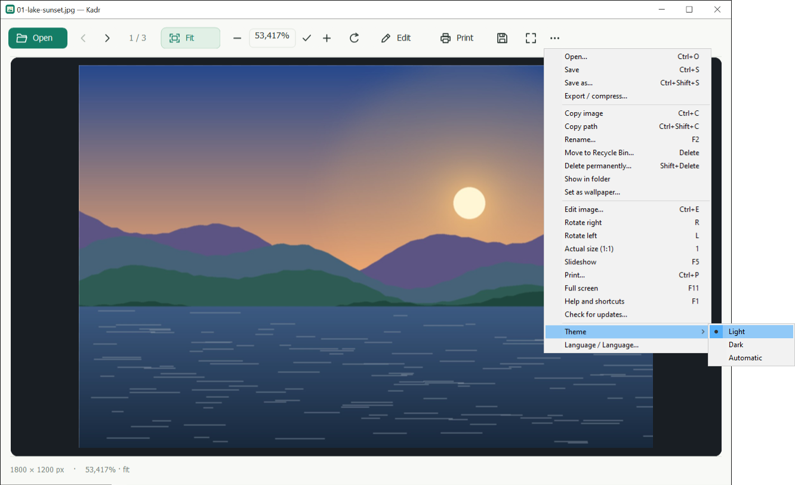

[English](../README.md) | [Polski](README.pl.md) | [Español](README.es.md) | **Français** | [Deutsch](README.de.md) | [Português](README.pt.md) | [Русский](README.ru.md) | [Українська](README.uk.md) | [Italiano](README.it.md) | [Nederlands](README.nl.md) | [Čeština](README.cs.md) | [Magyar](README.hu.md) | [Română](README.ro.md) | [Türkçe](README.tr.md) | [Ελληνικά](README.el.md) | [العربية](README.ar.md) | [עברית](README.he.md) | [हिन्दी](README.hi.md) | [বাংলা](README.bn.md) | [اردو](README.ur.md) | [中文](README.zh.md) | [日本語](README.ja.md) | [한국어](README.ko.md) | [Bahasa Indonesia](README.id.md) | [Tiếng Việt](README.vi.md) | [ไทย](README.th.md) | [فارسی](README.fa.md) | [தமிழ்](README.ta.md) | [తెలుగు](README.te.md) | [मराठी](README.mr.md)

# Kadr

**Une visionneuse et un éditeur de photos rapide, minuscule et portable pour Windows — de Windows XP à Windows 11, dans un seul `Kadr.exe` de moins de 1 MB.**

Kadr est une application native Win32/GDI+ écrite en [Zig](https://ziglang.org/). Pas d’installateur, pas de .NET, pas d’Electron, pas de Node.js : copiez `Kadr.exe` où vous voulez et lancez-le. Les paramètres sont enregistrés dans `Kadr.ini`, à côté du programme (portable — rien n’est écrit dans le registre ni dans AppData).


## Table des matières

- [Fonctionnalités](#fonctionnalités)
- [Captures d’écran](#captures-décran)
- [Téléchargement / Installation](#téléchargement--installation)
- [Utilisation](#utilisation)
- [Raccourcis clavier](#raccourcis-clavier)
- [Éditeur](#éditeur-1)
- [Impression](#impression)
- [Thèmes](#thèmes)
- [Paramètres (Kadr.ini)](#paramètres-kadrini)
- [Compilation depuis les sources](#compilation-depuis-les-sources)
- [Exécution des tests](#exécution-des-tests)
- [Licence](#licence)
- [Crédits](#crédits)

## Fonctionnalités

- **Visionneuse** — ouverture de photos, navigation dans le dossier (touches fléchées, précédente/suivante), diaporama, plein écran, zoom fluide (ajustement, 1:1, molette de la souris à l’emplacement du curseur, valeurs saisies comme `125%`, `37,5%` ou `200×`), déplacement de l’image, lecture des GIF animés, TIFF et DjVu multipages, orientation EXIF automatique.
- **Éditeur** — recadrage avec un cadre en direct et des proportions prédéfinies (libre, 1:1, 4:3, 3:4, 3:2, 2:3, 16:9, A4 portrait/paysage) ; stylo, surligneur, gomme, ligne, flèche, rectangle et texte ; annuler/rétablir ; rotation et retournement ; luminosité, contraste, saturation et noir et blanc. Les modifications restent en mémoire jusqu’à ce que vous enregistriez.
- **Impression** — aperçu avant impression en direct avec format du papier, orientation, échelle (ajustée / remplie (rognée) / étirée (page entière) / 100% / pourcentage personnalisé / largeur ou hauteur en mm), marges, position, couleur ou niveaux de gris.
- **Outils de fichier** — enregistrer (rotation), enregistrer sous, exporter / compresser (PNG, JPEG, BMP, TIFF, GIF) avec redimensionnement et estimation de la taille, copier l’image ou son chemin dans le presse-papiers, renommer, mettre à la corbeille ou supprimer définitivement, afficher dans le dossier, définir comme fond d’écran.
- **Formats** — PNG, JPEG/JFIF, BMP/DIB, GIF, TIFF, DjVu, ICO, WMF/EMF, TGA, PCX, PSD (image fusionnée), PBM/PGM/PPM/PNM, QOI.
- **30 langues d’interface** — la langue de Windows est détectée automatiquement (à défaut, l’anglais est utilisé) et peut être changée depuis le menu ; disposition de droite à gauche pour l’arabe, l’hébreu, l’ourdou et le persan.
- **Thèmes** — clair, sombre ou automatique (suit le mode des applications de Windows et bascule en direct).
- **Léger** — un seul `Kadr.exe` de moins de 1 MB.
- **Windows XP et versions ultérieures** — fonctionne de Windows XP SP3 (x86) jusqu’à Windows 10/11.

## Captures d’écran

| Thème clair | Thème sombre |
|---|---|
|  |  |

**Éditeur** — cadre de recadrage avec le préréglage 3:2, stylo, surligneur, flèche, rectangle et texte :


**Aperçu avant impression** en mode *Stretch (whole page)* (étirer sur toute la page) :


**Le menu « Plus » (…)** avec le sous-menu *Thème* :



## Téléchargement / Installation

1. Téléchargez `Kadr.exe` depuis la [page des versions](https://github.com/snakex21/kadr/releases) (un `Kadr.exe` prêt à l’emploi est aussi conservé à la racine du dépôt).
2. Placez-le dans n’importe quel dossier où vous pouvez écrire (par exemple une clé USB) et lancez-le. Il n’y a pas d’installateur.
3. Pour les fichiers DjVu, conservez le dossier `deps\djvu\` du dépôt à côté de `Kadr.exe`.

Pour ouvrir les images d’un double-clic, utilisez dans Windows *Ouvrir avec → Choisir une autre application* sur une image et sélectionnez `Kadr.exe`.

**Configuration requise :** Windows XP SP3 x86 ou plus récent (Windows 10/11 conviennent aussi). Rien d’autre.

> Le décodeur DjVu est l’ancienne version DjVuLibre 3.5.27 — n’ouvrez que des fichiers DjVu de confiance (détails dans `THIRD-PARTY.txt`).

## Utilisation

- **Ouvrez** une image avec **Ouvrir** (Ctrl+O), en faisant glisser un fichier sur la fenêtre ou en le passant en ligne de commande : `Kadr.exe photo.jpg`.
- **Parcourez** le dossier avec ← / → ou les boutons fléchés ; le compteur indique la position (par ex. `1 / 3`). Maintenez une touche fléchée enfoncée pour défiler rapidement.
- **Zoomez** avec la molette de la souris (zoom à l’emplacement du curseur), `+` / `−`, **Ajuster** (Home), **1:1** (`1`) ou saisissez une valeur dans le champ de zoom et appuyez sur Enter. Faites glisser l’image pour la déplacer.
- **Faites pivoter** avec R / L. C’est l’affichage qui pivote ; **Enregistrer** (Ctrl+S) écrit la rotation dans le fichier.
- **Plus (…)** ouvre le menu regroupant toutes les opérations sur les fichiers, l’éditeur, l’impression, le diaporama, le plein écran, l’aide, *Rechercher des mises à jour…*, *Thème* et *Langue*.
- **Rechercher des mises à jour…** ouvre simplement la page des versions du projet sur GitHub dans votre navigateur — Kadr lui-même ne se connecte jamais à Internet.

## Raccourcis clavier

### Visionneuse

| Raccourci | Action |
|---|---|
| Ctrl+O | Ouvrir |
| Ctrl+S | Enregistrer (écrit la rotation dans le fichier courant) |
| Ctrl+Shift+S | Enregistrer sous |
| Ctrl+E | Modifier l’image |
| Ctrl+P | Imprimer |
| Ctrl+C | Copier l’image |
| Ctrl+Shift+C | Copier le chemin |
| F2 | Renommer |
| Delete | Mettre à la corbeille |
| Shift+Delete | Supprimer définitivement |
| ← / → | Image précédente / suivante dans le dossier (maintenir pour défiler rapidement) |
| Home | Ajuster à la fenêtre |
| 1 | Taille réelle (1:1) |
| + / − (aussi sur le pavé numérique) | Agrandir / Réduire |
| Molette de la souris | Zoom à l’emplacement du curseur |
| Glisser avec le bouton gauche | Déplacer l’image |
| Double-clic | Activer / désactiver le plein écran |
| R / L | Tourner à droite / Pivoter à gauche |
| Space | Mettre en pause / reprendre l’animation |
| Page Up / Page Down | Page précédente / suivante (TIFF, DjVu) |
| F5 | Diaporama (toutes les 4 secondes) |
| F11 | Plein écran |
| Esc | Quitter le plein écran, arrêter le diaporama |
| F1 | Aide et raccourcis |
| Shift+F10 ou la touche Menu | Menu « Plus » (aussi par clic droit sur l’image) |
| Tab / Shift+Tab, Enter ou Space | Passer d’un bouton de la barre d’outils à l’autre et les activer |

### Champ de zoom

| Raccourci | Action |
|---|---|
| Enter | Appliquer le zoom saisi (`125%`, `37,5%`, `200×` …) |
| Esc | Rétablir la valeur actuelle |
| Ctrl+A | Tout sélectionner |

### Éditeur

| Raccourci | Action |
|---|---|
| C | Rogner |
| P | Pen (stylo) |
| H | Highlighter (surligneur) |
| E | Eraser (gomme) |
| L | Line (ligne) |
| A | Arrow (flèche) |
| B | Rectangle |
| T | Text (texte) |
| Ctrl+Z | Undo (annuler) |
| Ctrl+Y ou Ctrl+Shift+Z | Redo (rétablir) |
| Enter (outil Rogner) ou double-clic | Couper la partie assombrie |
| Enter / Esc (pendant la saisie d’un texte) | Valider / annuler le texte |
| Esc | Fermer l’éditeur sans modifications |

### Aperçu avant impression

| Raccourci | Action |
|---|---|
| Faire glisser l’image sur la feuille | Changer sa position |
| Esc | Fermer l’aperçu (annule une impression en cours) |

## Éditeur

Ouvrez l’éditeur avec **Edit** (« Modifier », Ctrl+E). Toutes les modifications sont conservées en mémoire ; le fichier d’origine n’est pas touché tant que vous n’enregistrez pas.

- **Recadrage** — un cadre en direct avec huit poignées ; faites glisser le cadre ou ses poignées, saisissez les valeurs exactes X / Y / largeur / hauteur en pixels ou choisissez des proportions prédéfinies (libre, carré 1:1, 4:3, 3:4, 3:2 (4×6 paysage), 2:3, 16:9, A4 portrait, A4 paysage). La zone hors du cadre est assombrie ; **Rogner** (Enter) la supprime et **Whole photo** (photo entière) réinitialise le cadre.
- **Dessin** — stylo, surligneur translucide, gomme (n’efface que les dessins et le texte, jamais la photo), ligne droite, flèche, rectangle et texte, avec dix couleurs et une taille réglable.
- **Image** — annuler / rétablir, rotation de 90° à gauche ou à droite, miroir horizontal ou vertical, tout réinitialiser.
- **Couleur et lumière** — luminosité, contraste, saturation et noir et blanc.
- **Terminer** — *Appliquer* renvoie l’image modifiée à la visionneuse, *Save as…* enregistre une copie sous un nouveau nom, *Print…* passe directement à l’aperçu avant impression, *Annuler* (Esc) abandonne les modifications.

## Impression

**Imprimer** (Ctrl+P) ouvre un aperçu en direct de la feuille. Choisissez l’imprimante, le papier (A3–A6, B4/B5, Letter, Legal, Executive, Tabloid, formats photo 10×15, 13×18, 15×20, 20×25 cm, 4×6, 5×7, 8×10 in, personnalisé ou celui de l’imprimante), l’orientation et la couleur ou les niveaux de gris. L’orientation suit automatiquement l’image jusqu’à ce que vous la changiez.

Modes d’échelle :

| Mode | Effet |
|---|---|
| **Ajuster** | L’image entière tient dans les marges ; les proportions sont conservées, des bandes blanches peuvent subsister sur deux côtés. |
| **Remplir / rogner** | L’image couvre toute la zone imprimable ; les proportions sont conservées et les bords qui dépassent sont rognés. |
| **Stretch (whole page)** (étirer sur toute la page) | L’image est étirée exactement sur la zone imprimable — sans bandes blanches, mais les proportions ne sont **pas** conservées. |
| **100% · Taille réelle (96 DPI)** | Un pixel = 1/96 de pouce. |
| **Pourcentage personnalisé** | 0,1–1000 % par rapport à 96 DPI (100% = la taille ci-dessus). |
| **Largeur (mm)** / **Hauteur (mm)** | Largeur ou hauteur physique exacte ; l’autre côté suit les proportions. |

**Avancé ▸** ajoute le format de papier personnalisé, les marges et une position exacte sur la feuille (ou faites glisser l’image dans l’aperçu ; *Centrer* la replace au milieu). La ligne grise indique la limite matérielle de l’imprimante. Le dernier mode d’échelle choisi est mémorisé dans `Kadr.ini`.

## Thèmes

**Plus (…) → Thème** propose **Clair**, **Sombre** et **Automatique** (par défaut).

- **Automatique** suit le *mode des applications* de Windows (Paramètres → Personnalisation → Couleurs, la valeur `AppsUseLightTheme`) et bascule en direct lorsque vous le changez dans Windows. Sur les systèmes qui n’ont pas ce paramètre (Windows XP, Vista, 7, 8), Automatique équivaut à Clair.
- Le thème s’applique à la fenêtre principale, à la barre d’outils, aux boutons et aux icônes, à l’éditeur, à l’aperçu avant impression et aux boîtes de dialogue propres à Kadr. En mode sombre, le fond de l’image est gris foncé et, sous Windows 10/11, les barres de titre et les menus contextuels sont eux aussi sombres.
- Quelques éléments natifs de Windows gardent l’apparence du système : les boîtes de message (aide, confirmations), les boîtes de dialogue système Ouvrir / Enregistrer / Imprimer et les curseurs des glissières.

## Paramètres (Kadr.ini)

Tous les paramètres sont enregistrés dans `Kadr.ini`, à côté de `Kadr.exe`. Si le dossier est en lecture seule, Kadr vous signale que les paramètres ne peuvent pas être enregistrés.

```ini
[General]
Language=en      ; pl, en, es, fr, de, pt, ru, uk, it, nl, cs, hu, ro, tr, el, ar, he, hi, bn, ur, zh, ja, ko, id, vi, th, fa, ta, te, mr
Theme=auto       ; auto, light or dark
[Print]
Scale=fit        ; fit, fill, stretch, actual, percent, width or height
```

La langue peut aussi être choisie via **Plus (…) → Langue** ; le changement prend effet après le redémarrage de Kadr. Le thème s’applique immédiatement.

Langues de l’interface : Polski, English, Español, Français, Deutsch, Português, Русский, Українська, Italiano, Nederlands, Čeština, Magyar, Română, Türkçe, Ελληνικά, العربية, עברית, हिन्दी, বাংলা, اردو, 中文, 日本語, 한국어, Bahasa Indonesia, Tiếng Việt, ไทย, فارسی, தமிழ், తెలుగు, मराठी.

## Compilation depuis les sources

Prérequis : [Zig 0.11.0](https://ziglang.org/download/0.11.0/zig-windows-x86_64-0.11.0.zip) décompressé dans `tools\zig-windows-x86_64-0.11.0\` (l’archive ne fait pas partie du dépôt ; son SHA-256 figure dans `THIRD-PARTY.txt`).

```bat
build.cmd
```

Le résultat est `Kadr.exe` (cible `x86-windows.xp`, Pentium III, `ReleaseSmall`) avec un en-tête PE compatible XP. Pour régénérer l’icône : `tools\build_icon.cmd` (Pillow + windres/objcopy).

Kadr n’est lié qu’à des bibliothèques présentes sous Windows XP. Les fonctions plus récentes (barres de titre sombres, menus et contrôles sombres) sont chargées à l’exécution avec `LoadLibrary` / `GetProcAddress` et sont ignorées sur les systèmes plus anciens.

## Exécution des tests

- Les suites de tests se trouvent dans des sous-dossiers de `tests\` (`editor-check`, `print-options`, `loader-check`, `image-check`, `codec-check`, `render-check`, `export-check`) ; chacune se lance avec son `check.cmd`, qui compile et exécute des bancs d’essai Zig. `tests\editor-check\check.cmd` exécute les tests de la fenêtre principale (y compris ceux du paramètre de thème et de la résolution du thème), les tests de l’éditeur, la vérification de la couverture linguistique et une compilation candidate x86/XP ; `tests\print-options\check.cmd` exécute les tests d’impression et de mise en page.
- Les tests unitaires d’un module donné peuvent être lancés avec `zig test`, par ex. `zig test src\toolbar.zig`, `src\navigation.zig`, `src\image.zig`, `src\zoom.zig`, `src\theme.zig` (avec la même cible et les mêmes options d’inclusion que dans `check.cmd`).
- Scripts d’aide Python 3 : `python tests\i18n-check\run.py` (sélection de la langue), `python tests\locale_coverage.py` (toutes les chaînes de l’interface figurent dans le catalogue pour les 30 langues), `python tests\audit_xp.py` (audit des imports et de l’en-tête XP de `Kadr.exe`), `tests\measure_print.py`, `tests\tooltip_probe.py`, `tests\shot.py`.
- `tests\generate_fixtures.py` crée des images de test (nécessite Pillow) ; il ne sert qu’au développement, jamais à `Kadr.exe`.

## Licence

**GPL-3.0-or-later** — texte intégral dans [`LICENSE`](../LICENSE).

Composants tiers et leurs licences (DjVuLibre, VC100/GDI+, Zig) : [`THIRD-PARTY.txt`](../THIRD-PARTY.txt). Texte de la GNU GPL v2 pour DjVuLibre : [`COPYING.txt`](../COPYING.txt).

Ceci est une traduction ; seule la version anglaise ([README.md](../README.md)) fait foi.

## Crédits

- Réalisé avec [Zig](https://ziglang.org/) sur Win32 et GDI+.
- Décodage DjVu : [DjVuLibre](https://djvu.sourceforge.net/) 3.5.27 (GPL-2.0-or-later).
- Les icônes de l’interface et le logo de Kadr sont des créations originales du projet (`src/ui.zig`, `tools/make_icon.py`).
- Les images visibles sur les captures d’écran sont des images de synthèse générées pour ce README.
