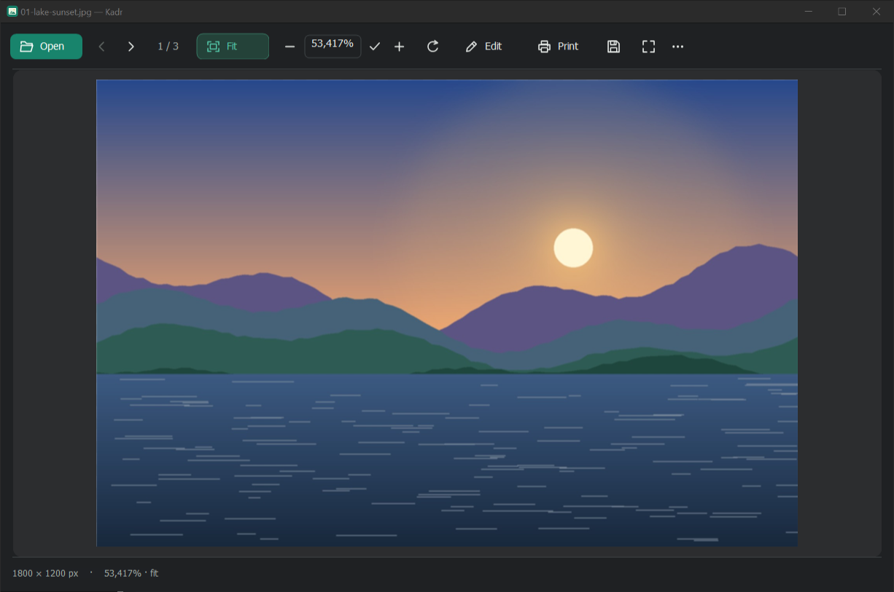
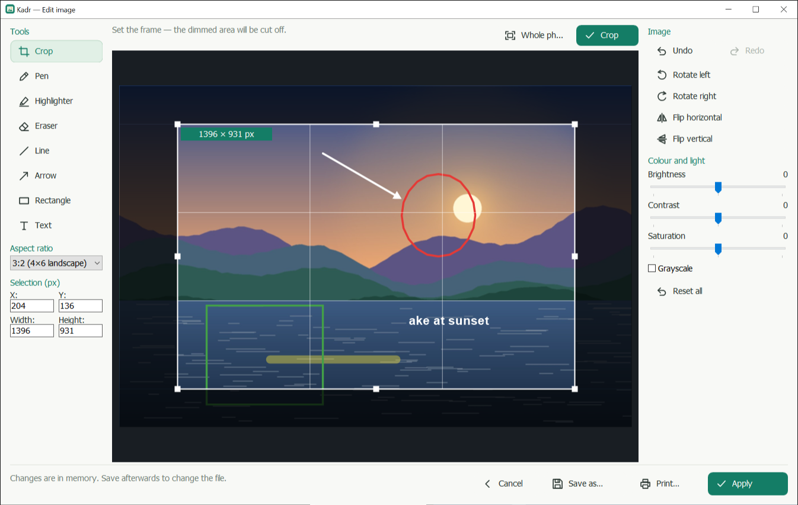

[English](../README.md) | [Polski](README.pl.md) | [Español](README.es.md) | [Français](README.fr.md) | [Deutsch](README.de.md) | [Português](README.pt.md) | [Русский](README.ru.md) | [Українська](README.uk.md) | [Italiano](README.it.md) | [Nederlands](README.nl.md) | [Čeština](README.cs.md) | [Magyar](README.hu.md) | [Română](README.ro.md) | [Türkçe](README.tr.md) | [Ελληνικά](README.el.md) | [العربية](README.ar.md) | [עברית](README.he.md) | [हिन्दी](README.hi.md) | [বাংলা](README.bn.md) | **اردو** | [中文](README.zh.md) | [日本語](README.ja.md) | [한국어](README.ko.md) | [Bahasa Indonesia](README.id.md) | [Tiếng Việt](README.vi.md) | [ไทย](README.th.md) | [فارسی](README.fa.md) | [தமிழ்](README.ta.md) | [తెలుగు](README.te.md) | [मराठी](README.mr.md)

<div dir="rtl">

# Kadr

**Windows کے لیے ایک تیز، ننھا اور پورٹیبل تصویر ویوئر اور ایڈیٹر — Windows XP سے Windows 11 تک، 1 MB سے کم کی ایک ہی `Kadr.exe` فائل میں۔**

Kadr ایک نیٹو Win32/GDI+ ایپلیکیشن ہے جو [Zig](https://ziglang.org/) میں لکھی گئی ہے۔ نہ انسٹالر، نہ .NET، نہ Electron، نہ Node.js: `Kadr.exe` کو کہیں بھی کاپی کریں اور چلا دیں۔ ترتیبات پروگرام کے ساتھ `Kadr.ini` میں محفوظ ہوتی ہیں (پورٹیبل — رجسٹری یا AppData میں کچھ نہیں لکھا جاتا)۔


## فہرست مضامین

- [خصوصیات](#خصوصیات)
- [اسکرین شاٹس](#اسکرین-شاٹس)
- [ڈاؤن لوڈ / انسٹالیشن](#ڈاؤن-لوڈ--انسٹالیشن)
- [استعمال](#استعمال)
- [کی بورڈ شارٹ کٹس](#کی-بورڈ-شارٹ-کٹس)
- [ایڈیٹر](#ایڈیٹر-1)
- [پرنٹنگ](#پرنٹنگ)
- [تھیمز](#تھیمز)
- [ترتیبات (Kadr.ini)](#ترتیبات-kadrini)
- [سورس سے بلڈ کرنا](#سورس-سے-بلڈ-کرنا)
- [ٹیسٹ چلانا](#ٹیسٹ-چلانا)
- [لائسنس](#لائسنس)
- [اعترافات](#اعترافات)

## خصوصیات

- **ویوئر** — تصاویر کھولنا، فولڈر میں آگے پیچھے جانا (تیر والی کلیدیں، پچھلی/اگلی)، سلائیڈ شو، پوری اسکرین، ہموار زوم (فٹ، 1:1، کرسر کی جگہ پر ماؤس وہیل، ٹائپ کی گئی قدریں جیسے `125%`، `37,5%` یا `200×`)، تصویر کو کھسکانا، متحرک GIF چلانا، کئی صفحات والی TIFF اور DjVu، خودکار EXIF رخ۔
- **ایڈیٹر** — براہ راست فریم اور تیار تناسب (آزاد، 1:1، 4:3، 3:4، 3:2، 2:3، 16:9، A4 عمودی/افقی) کے ساتھ تراشنا؛ قلم، ہائی لائٹر، ربڑ، لکیر، تیر، مستطیل اور متن؛ واپس/دوبارہ؛ گھمانا اور پلٹنا؛ چمک، کنٹراسٹ، سیرابی اور سیاہ و سفید۔ تبدیلیاں محفوظ کرنے تک میموری ہی میں رہتی ہیں۔
- **پرنٹنگ** — براہ راست پرنٹ پیش نظارہ، جس میں کاغذ کا سائز، رخ، پیمانہ (فٹ کریں (پوری تصویر) / بھریں (تراشیں) / پھیلائیں (پورا صفحہ) / 100% / اپنا % / mm میں چوڑائی یا اونچائی)، حاشیے، مقام، رنگین یا سرمئی۔
- **فائل ٹولز** — محفوظ کرنا (گھماؤ)، دوسرے نام سے محفوظ کرنا، برآمد / دبانا (PNG، JPEG، BMP، TIFF، GIF) سائز بدلنے اور فائل سائز کے تخمینے کے ساتھ، تصویر یا راستہ کلپ بورڈ میں نقل کرنا، نام بدلنا، ری سائیکل بن یا مستقل حذف، فولڈر میں دکھانا، ڈیسک ٹاپ وال پیپر بنانا۔
- **فارمیٹس** — PNG، JPEG/JFIF، BMP/DIB، GIF، TIFF، DjVu، ICO، WMF/EMF، TGA، PCX، PSD (ضم شدہ تصویر)، PBM/PGM/PPM/PNM، QOI۔
- **انٹرفیس کی 30 زبانیں** — Windows کی زبان خودبخود پہچانی جاتی ہے (ورنہ انگریزی) اور مینو سے بدلی جا سکتی ہے؛ عربی، عبرانی، اردو اور فارسی کے لیے دائیں سے بائیں ترتیب۔
- **تھیمز** — ہلکی، گہری یا خودکار (Windows کے ایپ موڈ کی پیروی کرتی ہے اور فوراً بدل جاتی ہے)۔
- **چھوٹا** — 1 MB سے کم کی ایک ہی `Kadr.exe`۔
- **Windows XP اور نئے** — Windows XP SP3 (x86) سے Windows 10/11 تک چلتا ہے۔

## اسکرین شاٹس

| ہلکی تھیم | گہری تھیم |
|---|---|
|  |  |

**ایڈیٹر** — 3:2 تناسب والا تراشنے کا فریم، قلم، ہائی لائٹر، تیر، مستطیل اور متن:



*پھیلائیں (پورا صفحہ)* موڈ میں **پرنٹ پیش نظارہ**:


*تھیم* ذیلی مینو کے ساتھ **"مزید" (…) مینو**:


## ڈاؤن لوڈ / انسٹالیشن

1. `Kadr.exe` کو [ریلیزز کے صفحے](https://github.com/snakex21/kadr/releases) سے ڈاؤن لوڈ کریں (ایک تیار `Kadr.exe` ریپوزیٹری کی جڑ میں بھی رکھی ہے)۔
2. اسے کسی بھی ایسے فولڈر میں رکھیں جس میں آپ لکھ سکتے ہوں (مثلاً USB اسٹک) اور چلائیں۔ کوئی انسٹالر نہیں ہے۔
3. DjVu فائلوں کے لیے ریپوزیٹری کا `deps\djvu\` فولڈر `Kadr.exe` کے ساتھ رکھیں۔

تصاویر کو ڈبل کلک سے کھولنے کے لیے کسی تصویر پر Windows کا *اس کے ساتھ کھولیں → کوئی دوسری ایپ منتخب کریں* استعمال کریں اور `Kadr.exe` چنیں۔

**ضروریات:** Windows XP SP3 x86 یا نیا (Windows 10/11 پر بھی چلتا ہے)۔ اور کچھ نہیں۔

> DjVu ڈیکوڈر پرانا DjVuLibre 3.5.27 ہے — صرف وہی DjVu فائلیں کھولیں جن پر آپ کو بھروسا ہو (تفصیل `THIRD-PARTY.txt` میں)۔

## استعمال

- **کھولیں**: تصویر کو **کھولیں** (Ctrl+O) سے، فائل کو ونڈو پر گھسیٹ کر، یا کمانڈ لائن میں دے کر کھولیں: `Kadr.exe photo.jpg`۔
- **براؤز**: فولڈر میں ← / → یا تیر والے بٹنوں سے آگے پیچھے جائیں؛ کاؤنٹر مقام دکھاتا ہے (مثلاً `1 / 3`)۔ تیزی سے براؤز کرنے کے لیے تیر والی کلید دبائے رکھیں۔
- **زوم**: ماؤس وہیل (کرسر کی جگہ پر زوم)، `+` / `−`، **فٹ کریں** (Home)، **1:1** (`1`) استعمال کریں، یا زوم خانے میں قدر لکھ کر Enter دبائیں۔ تصویر کو کھسکانے کے لیے گھسیٹیں۔
- **گھمائیں**: R / L سے۔ صرف منظر گھومتا ہے؛ **محفوظ کریں** (Ctrl+S) گھماؤ کو فائل میں لکھ دیتا ہے۔
- **مزید (…)** وہ مینو کھولتا ہے جس میں تمام فائل آپریشنز، ایڈیٹر، پرنٹ، سلائیڈ شو، پوری اسکرین، مدد، *اپ ڈیٹس چیک کریں…*، *تھیم* اور *زبان* موجود ہیں۔
- **اپ ڈیٹس چیک کریں…** صرف آپ کے ویب براؤزر میں پروجیکٹ کا GitHub ریلیزز صفحہ کھولتا ہے — Kadr خود کبھی انٹرنیٹ سے نہیں جڑتا۔

## کی بورڈ شارٹ کٹس

### ویوئر

| شارٹ کٹ | عمل |
|---|---|
| Ctrl+O | کھولیں |
| Ctrl+S | محفوظ کریں (گھماؤ کو موجودہ فائل میں لکھتا ہے) |
| Ctrl+Shift+S | دوسرے نام سے محفوظ کریں |
| Ctrl+E | تصویر میں ترمیم |
| Ctrl+P | پرنٹ کریں |
| Ctrl+C | تصویر نقل کریں |
| Ctrl+Shift+C | راستہ نقل کریں |
| F2 | نام بدلیں |
| Delete | ری سائیکل بن میں بھیجیں |
| Shift+Delete | مستقل حذف کریں |
| ← / → | فولڈر میں پچھلی / اگلی تصویر (تیزی سے براؤز کرنے کے لیے دبائے رکھیں) |
| Home | ونڈو میں فٹ |
| 1 | اصل سائز (1:1) |
| + / − (نیومیرک کی پیڈ پر بھی) | بڑا کریں / چھوٹا کریں |
| ماؤس وہیل | کرسر کی جگہ پر زوم |
| بائیں بٹن سے گھسیٹنا | تصویر کھسکانا |
| ڈبل کلک | پوری اسکرین آن / آف |
| R / L | دائیں / بائیں گھمائیں |
| Space | اینیمیشن روکیں / دوبارہ چلائیں |
| Page Up / Page Down | پچھلا / اگلا صفحہ (TIFF، DjVu) |
| F5 | سلائیڈ شو (ہر 4 سیکنڈ) |
| F11 | پوری اسکرین |
| Esc | پوری اسکرین سے نکلیں، سلائیڈ شو روکیں |
| F1 | مدد اور شارٹ کٹس |
| Shift+F10 یا مینو کلید | "مزید" مینو (تصویر پر دایاں کلک بھی) |
| Tab / Shift+Tab، Enter یا Space | ٹول بار کے بٹنوں کے درمیان جانا اور انہیں دبانا |

### زوم خانہ

| شارٹ کٹ | عمل |
|---|---|
| Enter | لکھا گیا زوم لاگو کریں (`125%`، `37,5%`، `200×` …) |
| Esc | موجودہ قدر بحال کریں |
| Ctrl+A | سب منتخب کریں |

### ایڈیٹر

| شارٹ کٹ | عمل |
|---|---|
| C | تراشیں |
| P | قلم |
| H | ہائی لائٹر |
| E | ربڑ |
| L | لکیر |
| A | تیر |
| B | مستطیل |
| T | متن |
| Ctrl+Z | کالعدم |
| Ctrl+Y یا Ctrl+Shift+Z | دوبارہ کریں |
| Enter (تراشیں ٹول) یا ڈبل کلک | دھندلا کیا گیا حصہ کاٹ دیں |
| Enter / Esc (متن لکھتے وقت) | متن مکمل / منسوخ کریں |
| Esc | بغیر تبدیلی کے ایڈیٹر بند کریں |

### پرنٹ پیش نظارہ

| شارٹ کٹ | عمل |
|---|---|
| تصویر کو شیٹ پر گھسیٹنا | اس کا مقام بدلنا |
| Esc | پیش نظارہ بند کریں (جاری پرنٹ کام منسوخ کرتا ہے) |

## ایڈیٹر

ایڈیٹر **ترمیم** (Ctrl+E) سے کھولیں۔ تمام تبدیلیاں میموری میں رکھی جاتی ہیں؛ جب تک آپ محفوظ نہ کریں اصل فائل کو چھوا نہیں جاتا۔

- **تراشیں** — آٹھ ہینڈلز والا براہ راست فریم؛ فریم یا اس کے ہینڈلز کو گھسیٹیں، پکسلز میں درست X / Y / چوڑائی / اونچائی لکھیں، یا کوئی تیار تناسب چنیں (آزاد، مربع 1:1، 4:3، 3:4، 3:2 (4×6 افقی)، 2:3، 16:9، A4 عمودی، A4 افقی)۔ فریم کے باہر کا حصہ دھندلا ہو جاتا ہے؛ **تراشیں** (Enter) اسے کاٹ دیتا ہے اور **پوری تصویر** فریم کو دوبارہ ترتیب دیتا ہے۔
- **ڈرائنگ** — قلم، نیم شفاف ہائی لائٹر، ربڑ (صرف ڈرائنگ اور متن مٹاتا ہے، تصویر کبھی نہیں)، سیدھی لکیر، تیر، مستطیل اور متن، دس رنگوں اور قابلِ تبدیل موٹائی کے ساتھ۔
- **تصویر** — واپس / دوبارہ، بائیں یا دائیں 90° گھمانا، افقی یا عمودی پلٹنا، سب دوبارہ ترتیب دینا۔
- **رنگ اور روشنی** — چمک، کنٹراسٹ، سیرابی اور سیاہ و سفید۔
- **اختتام** — *لاگو کریں* ترمیم شدہ تصویر ویوئر میں واپس بھیجتا ہے، *دوسرے نام سے محفوظ کریں…* نئے نام سے ایک نقل محفوظ کرتا ہے، *پرنٹ کریں…* سیدھا پرنٹ پیش نظارے پر لے جاتا ہے، *منسوخ کریں* (Esc) تبدیلیاں رد کر دیتا ہے۔

## پرنٹنگ

**پرنٹ کریں** (Ctrl+P) شیٹ کا براہ راست پیش نظارہ کھولتا ہے۔ پرنٹر، کاغذ (A3–A6، B4/B5، Letter، Legal، Executive، Tabloid، فوٹو سائز 10×15، 13×18، 15×20، 20×25 cm، 4×6، 5×7، 8×10 in، اپنا یا پرنٹر کا اپنا)، رخ اور رنگین یا سرمئی منتخب کریں۔ جب تک آپ رخ خود نہ بدلیں، وہ خودبخود تصویر کے مطابق رہتا ہے۔

پیمانے کے موڈ:

| موڈ | کیا کرتا ہے |
|---|---|
| **فٹ کریں (پوری تصویر)** | پوری تصویر حاشیوں کے اندر سما جاتی ہے؛ تناسب برقرار رہتا ہے، دو اطراف میں سفید جگہ رہ سکتی ہے۔ |
| **بھریں (تراشیں)** | تصویر پورے قابلِ پرنٹ حصے کو ڈھانپ لیتی ہے؛ تناسب برقرار رہتا ہے اور باہر نکلتے کنارے تراش دیے جاتے ہیں۔ |
| **پھیلائیں (پورا صفحہ)** | تصویر کو ٹھیک قابلِ پرنٹ حصے تک پھیلا دیا جاتا ہے — کوئی سفید پٹی نہیں، لیکن تناسب برقرار **نہیں** رہتا۔ |
| **100% · اصل سائز (96 DPI)** | ایک پکسل = 1/96 انچ۔ |
| **اپنا فیصد** | 96 DPI کے لحاظ سے 0.1–1000 % (100% = اوپر والا سائز)۔ |
| **چوڑائی / اونچائی (mm)** | درست طبعی چوڑائی یا اونچائی؛ دوسری طرف تناسب کے مطابق رہتی ہے۔ |

**اعلیٰ ▸** اپنا کاغذی سائز، حاشیے اور شیٹ پر درست مقام شامل کرتا ہے (یا پیش نظارے میں تصویر گھسیٹیں؛ *درمیان* اسے واپس بیچ میں رکھ دیتا ہے)۔ سرمئی لکیر پرنٹر کی ہارڈویئر حد دکھاتی ہے۔ آخری منتخب پیمانہ موڈ `Kadr.ini` میں یاد رکھا جاتا ہے۔

## تھیمز

**مزید (…) → تھیم** میں **ہلکا**، **گہرا** اور **خودکار** (طے شدہ) دستیاب ہیں۔

- **خودکار** Windows کے *ایپ موڈ* (ترتیبات → ذاتی نوعیت → رنگ، `AppsUseLightTheme` قدر) کی پیروی کرتا ہے اور جب آپ اسے Windows میں بدلیں تو فوراً بدل جاتا ہے۔ جن سسٹمز میں یہ ترتیب نہیں (Windows XP، Vista، 7، 8) وہاں خودکار کا مطلب ہلکا ہے۔
- تھیم مرکزی ونڈو، ٹول بار، بٹنوں اور آئیکنز، ایڈیٹر، پرنٹ پیش نظارے اور Kadr کے اپنے ڈائیلاگز پر لاگو ہوتی ہے۔ گہرے موڈ میں تصویر کا پس منظر گہرا سرمئی ہوتا ہے، اور Windows 10/11 پر ٹائٹل بار اور پاپ اپ مینو بھی گہرے ہوتے ہیں۔
- Windows کے چند نیٹو حصے سسٹم والی شکل برقرار رکھتے ہیں: پیغام کے خانے (مدد، تصدیقیں)، کھولیں / محفوظ کریں / پرنٹ کے سسٹم ڈائیلاگ اور سلائیڈر کے ہینڈل۔

## ترتیبات (Kadr.ini)

تمام ترتیبات `Kadr.exe` کے ساتھ `Kadr.ini` میں محفوظ ہوتی ہیں۔ اگر فولڈر صرف پڑھنے کے لیے ہو تو Kadr بتا دیتا ہے کہ ترتیبات محفوظ نہیں ہو سکتیں۔

</div>

```ini
[General]
Language=en      ; pl, en, es, fr, de, pt, ru, uk, it, nl, cs, hu, ro, tr, el, ar, he, hi, bn, ur, zh, ja, ko, id, vi, th, fa, ta, te, mr
Theme=auto       ; auto, light or dark
[Print]
Scale=fit        ; fit, fill, stretch, actual, percent, width or height
```

<div dir="rtl">

زبان **مزید (…) → زبان / Language…** سے بھی چنی جا سکتی ہے؛ تبدیلی Kadr دوبارہ چلانے کے بعد لاگو ہوتی ہے۔ تھیم فوراً لاگو ہو جاتی ہے۔

انٹرفیس کی زبانیں: Polski, English, Español, Français, Deutsch, Português, Русский, Українська, Italiano, Nederlands, Čeština, Magyar, Română, Türkçe, Ελληνικά, العربية, עברית, हिन्दी, বাংলা, اردو, 中文, 日本語, 한국어, Bahasa Indonesia, Tiếng Việt, ไทย, فارسی, தமிழ், తెలుగు, मराठी.

## سورس سے بلڈ کرنا

ضروریات: [Zig 0.11.0](https://ziglang.org/download/0.11.0/zig-windows-x86_64-0.11.0.zip)، جسے `tools\zig-windows-x86_64-0.11.0\` میں کھولا گیا ہو (آرکائیو ریپوزیٹری کا حصہ نہیں؛ اس کا SHA-256 `THIRD-PARTY.txt` میں ہے)۔

</div>

```bat
build.cmd
```

<div dir="rtl">

نتیجہ `Kadr.exe` ہے (ہدف `x86-windows.xp`، Pentium III، `ReleaseSmall`) جس کا PE ہیڈر XP سے مطابقت رکھتا ہے۔ آئیکن دوبارہ بنانا: `tools\build_icon.cmd` (Pillow + windres/objcopy)۔

Kadr صرف انہی لائبریریوں سے لنک کرتا ہے جو Windows XP میں موجود ہیں۔ نئی خصوصیات (گہرے ٹائٹل بار، گہرے مینو اور کنٹرولز) چلتے وقت `LoadLibrary` / `GetProcAddress` کے ذریعے لوڈ کی جاتی ہیں اور پرانے سسٹمز پر چھوڑ دی جاتی ہیں۔

## ٹیسٹ چلانا

- ٹیسٹ سوئٹس `tests\` کے ذیلی فولڈرز (`editor-check`، `print-options`، `loader-check`، `image-check`، `codec-check`، `render-check`، `export-check`) میں ہیں؛ ہر ایک اپنی `check.cmd` سے شروع ہوتا ہے، جو Zig ٹیسٹ ہارنس بلڈ کر کے چلاتی ہے۔ `tests\editor-check\check.cmd` مرکزی ونڈو کے ٹیسٹ (بشمول تھیم ترتیب اور تھیم کے تعین کے ٹیسٹ)، ایڈیٹر کے ٹیسٹ، زبانوں کی کوریج کی جانچ اور ایک x86/XP امیدوار بلڈ چلاتی ہے؛ `tests\print-options\check.cmd` پرنٹنگ اور لے آؤٹ کے ٹیسٹ چلاتی ہے۔
- الگ الگ ماڈیولز کے یونٹ ٹیسٹ `zig test` سے چلائے جا سکتے ہیں، مثلاً `zig test src\toolbar.zig`، `src\navigation.zig`، `src\image.zig`، `src\zoom.zig`، `src\theme.zig` (`check.cmd` والے ہی ہدف اور include فلیگز کے ساتھ)۔
- Python 3 کے معاون اسکرپٹس: `python tests\i18n-check\run.py` (زبان کا انتخاب)، `python tests\locale_coverage.py` (انٹرفیس کی تمام عبارتیں 30 زبانوں کے کیٹلاگ میں ہیں)، `python tests\audit_xp.py` (`Kadr.exe` کی XP امپورٹ/ہیڈر جانچ)، `tests\measure_print.py`، `tests\tooltip_probe.py`، `tests\shot.py`۔
- `tests\generate_fixtures.py` ٹیسٹ تصاویر بناتا ہے (Pillow درکار ہے)؛ یہ صرف ڈیولپمنٹ کے لیے ہے، `Kadr.exe` اسے کبھی استعمال نہیں کرتا۔

## لائسنس

**GPL-3.0-or-later** — مکمل متن [`LICENSE`](../LICENSE) میں۔

تیسرے فریق کے اجزاء اور ان کے لائسنس (DjVuLibre، VC100/GDI+، Zig): [`THIRD-PARTY.txt`](../THIRD-PARTY.txt)۔ DjVuLibre کے لیے GNU GPL v2 کا متن: [`COPYING.txt`](../COPYING.txt)۔

یہ ایک ترجمہ ہے؛ مستند انگریزی نسخہ ([README.md](../README.md)) ہے۔

## اعترافات

- Win32 اور GDI+ پر [Zig](https://ziglang.org/) کے ساتھ بنایا گیا۔
- DjVu ڈیکوڈنگ: [DjVuLibre](https://djvu.sourceforge.net/) 3.5.27 (GPL-2.0-or-later)۔
- انٹرفیس کے آئیکنز اور Kadr کا لوگو اس پروجیکٹ کا اپنا اصل فن پارہ ہیں (`src/ui.zig`، `tools/make_icon.py`)۔
- اسکرین شاٹس میں موجود تصاویر اس README کے لیے تیار کی گئی مصنوعی تصاویر ہیں۔

</div>
